# Learn Astro 🚀

<div align="center">

[](https://opensource.org/licenses/MIT)
[](https://astro.build)
[](https://github.com/TheLearningHubOrg/learn-astro/actions/workflows/ci.yml)
[](https://github.com/TheLearningHubOrg/learn-astro/releases)
[](https://docs.astro.build/en/concepts/islands/)
[](https://docs.astro.build/en/guides/typescript/)

**From your first `.astro` file to staff-level Astro architecture: islands, content, rendering modes and deployment.**  
Components, slots and layouts, client directives and hydration internals, content collections and loaders, endpoints, actions and middleware,  
on-demand rendering, server islands, route caching, view transitions, adapters, Docker and Core Web Vitals.

[Getting Started](#1-stage-1-setup-project-anatomy--the-rendering-model) • [Components](#2-stage-2-astro-components-templates-props--slots) • [Islands](#3-stage-3-islands-client-directives--client-side-state) • [Content](#4-stage-4-routing-content-collections--data-fetching) • [Server](#5-stage-5-endpoints-middleware-actions--testing) • [Deployment](#6-stage-6-on-demand-rendering-performance--deployment) • [Interview Prep](#7-stage-7-staff-astro-web-architect-interview-handbook--cheatsheet)

<br/>

<a href="https://www.buymeacoffee.com/manthanank">
  
</a>

</div>

> **Language used in this guide.** Every example is TypeScript inside `.astro` components and `.ts` modules, with HTML and CSS in the templates. Astro is a Vite and Node.js framework, its project templates ship a strict TypeScript config, and its APIs (`Astro.props`, `APIRoute`, `GetStaticPaths`, content schemas) are designed around TypeScript types. Framework islands appear in their own languages (React TSX, Svelte, Vue) only where a section is about those integrations.

> **Starter project.** The repository root is a runnable Astro 7 site: `src/` holds the pages, components and libraries the stages walk through, `test/` holds Vitest suites that render components with the Container API, and the `Dockerfile` serves the static build with unprivileged nginx on port 8080. Run it with `npm ci && npm run dev`, test it with `npm test`.

---

## 🗺️ 7-Stage Pedagogical Roadmap

```mermaid
flowchart LR
    S1["Stage 1: Setup and Rendering Model"] --> S2["Stage 2: Components and Templates"]
    S2 --> S3["Stage 3: Islands and Directives"]
    S3 --> S4["Stage 4: Routing and Content"]
    S4 --> S5["Stage 5: Endpoints, Middleware, Testing"]
    S5 --> S6["Stage 6: Rendering Modes and Deployment"]
    S6 --> M["Masterclasses M1-M5"]
    M --> S7["Stage 7: Staff Interview Handbook"]
```

| Stage | Focus Domain | Core Concepts & Engineering Outcomes |
| :--- | :--- | :--- |
| **Stage 1** | **Setup, Project Anatomy & the Rendering Model** | `npm create astro@latest`, `astro dev` / `build` / `preview` / `check` / `sync`, `src/pages` vs `public/`, `astro.config.mjs`, what lands in `dist/`. Outcome: explain why an Astro page ships zero JavaScript and read a build's output. |
| **Stage 2** | **Astro Components, Templates, Props & Slots** | The `---` fence, `interface Props`, `Astro.props`, expressions, `class:list`, `set:html`, default and named slots, `Astro.slots.has()`, layouts, scoped `<style>`, `:global()`, `define:vars`, first dynamic route with `getStaticPaths()`, a static `.json.ts` endpoint. Outcome: build and test a multi-page static site. |
| **Stage 3** | **Islands, Client Directives & Client-Side State** | `client:load` / `idle` / `visible` / `media` / `only`, directive options, the `<astro-island>` element and prop serialization, processed vs `is:inline` scripts, custom elements, framework integrations via `astro add`, Nanostores across frameworks. Outcome: add interactivity with a measured JavaScript budget. |
| **Stage 4** | **Routing, Content Collections & Data Fetching** | `src/content.config.ts`, `glob()` and `file()` loaders, Zod schemas from `astro/zod`, `getCollection()`, `render()`, MDX, i18n routing. Outcome: a typed content site that fails the build on bad frontmatter. |
| **Stage 5** | **Endpoints, Middleware, Actions & Testing** | `APIRoute`, `prerender = false`, `defineMiddleware`, `Astro.locals`, cookies, streaming responses, server-side payment sessions. Outcome: a small backend inside the same project. |
| **Stage 6** | **On-Demand Rendering, Performance & Deployment** | Static vs server output, adapters (Node, Cloudflare, Vercel, Netlify), `<Image />`, Core Web Vitals, multi-stage Docker, Lighthouse CI. Outcome: ship to a CDN or a container and keep it fast. |
| **Masterclasses** | **Server Islands, View Transitions, Multi-Framework, Search, Storefront** | `server:defer` internals, `<ClientRouter />` lifecycle, monorepos with shared islands, Pagefind, an end-to-end storefront. |
| **Stage 7** | **Staff Interview Handbook** | Interview Q&As with full answers, scenario questions and a one-page cheatsheet. |

---

## 🆕 Astro Versions, What's New & Migration

### V.1 Release Timeline

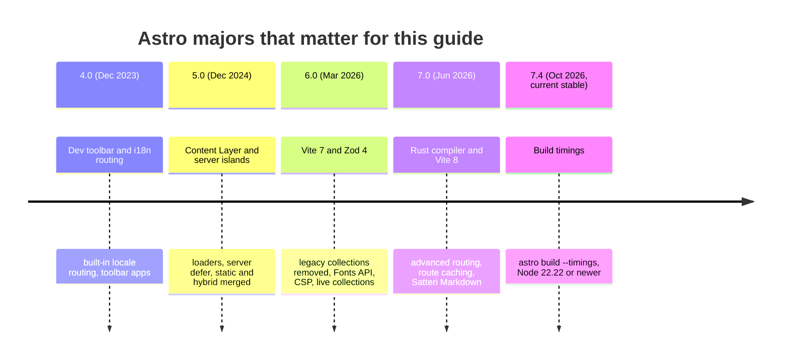

### V.2 Compatibility Matrix

| Astro | Released | Status (late 2026) | Node.js | Vite | Zod (content schemas) | Notes |
| --- | --- | --- | --- | --- | --- | --- |
| 7.4.x | Oct 2026 | Current stable | `>=22.23.4` (engines field of 7.4.5) | 8 | 4 | Rust compiler, Sätteri Markdown default |
| 7.0 | Jun 2026 | Superseded by 7.4 | 22.12+ (raised in 7.4) | 8 | 4 | First major on Vite 8 |
| 6.x | Mar 2026 | Previous major | `>=22.12.0` | 7 | 4 | Last line with the Go compiler as default |
| 5.x | Dec 2024 | Unmaintained | 18.17.1+, 20.3+, 22+ | 6 | 3 | `output: 'hybrid'` removed, Content Layer added |
| 4.x | Dec 2023 | Unmaintained | 18.14.1+ | 5 | 3 | Legacy `type: 'content'` collections |

The Astro CLI refuses to start on an older Node.js. The check lives in `node_modules/astro/bin/astro.mjs` and prints `Node.js v22.16.0 is not supported by Astro!` followed by the required range. Pin Node in `package.json` `engines`, `.nvmrc` and CI so all three agree.

### V.3 What's New in 7.x

#### Rust compiler replaces the Go compiler

`.astro` files are now compiled by `@astrojs/compiler-rs`. Builds are faster, and the compiler is stricter: markup that the Go compiler silently repaired is now an error or is passed through unchanged for the browser to handle.

```astro
---
// Before (6.x): the Go compiler closed the <p> for you.
---
<div>
  <p>Unclosed paragraph
</div>
```

```astro
---
// After (7.x): write valid HTML. An unclosed element is a compile error.
---
<div>
  <p>Closed paragraph</p>
</div>
```

#### `compressHTML: 'jsx'` is the default

Whitespace between elements is removed with JSX rules. A space between two inline elements on one line survives; a line break between them does not.

```astro
---
const first = 'Ada';
const last = 'Lovelace';
---
<!-- Before (6.x, HTML-aware compression): rendered "Ada Lovelace". -->
<!-- After (7.x, JSX rules): the newline is dropped and this renders "AdaLovelace". -->
<span>{first}</span>
<span>{last}</span>

<!-- Fix: keep the space explicitly. -->
<span>{first}</span>{' '}<span>{last}</span>
```

```js
// astro.config.mjs: restore the previous behaviour project-wide if a migration is too large.
import { defineConfig } from 'astro/config';

export default defineConfig({
  compressHTML: true, // HTML-aware compression (the 6.x default); false keeps all whitespace
});
```

#### Sätteri is the default Markdown processor

`.md` files render through `@astrojs/markdown-satteri` instead of remark and rehype. Projects that rely on remark or rehype plugins install the unified pipeline explicitly.

```js
// Before (6.x): plugins worked with no extra package.
import { defineConfig } from 'astro/config';
import remarkToc from 'remark-toc';

export default defineConfig({
  markdown: { remarkPlugins: [remarkToc] },
});
```

```js
// After (7.x): opt back into the unified pipeline, then plugins work as before.
import { defineConfig } from 'astro/config';
import { unified } from '@astrojs/markdown-remark';
import remarkToc from 'remark-toc';

export default defineConfig({
  markdown: {
    processor: unified(),
    remarkPlugins: [remarkToc],
  },
});
```

#### Advanced routing with `src/fetch.ts`

A `src/fetch.ts` file can own the whole request pipeline. Astro exposes its stages (`pages`, `middleware`, `actions`, `i18n`, `redirects`, `notFound`, `cache`) as handlers for `astro/fetch` and as Hono middleware from `astro/hono`, so you can put your own routing or auth in front of Astro's pages.

```ts
// src/fetch.ts (7.x, on-demand rendering with an adapter)
import { Hono } from 'hono';
import { pages } from 'astro/hono';

const app = new Hono();

// A plain Hono route that never touches Astro's renderer.
app.get('/api/ping', (c) => c.text('pong'));

// Everything else goes through Astro's pages, endpoints and 404 handling.
app.use(pages());

export default app;
```

If your project already used `src/fetch.ts` for something else, set `fetchFile: null` in the config. Projects on the 6.3 experiment move `experimental.advancedRouting.fetchFile` to the top-level `fetchFile` option.

#### Route caching is stable

`cache` and `routeRules` moved out of `experimental`. Pages and endpoints call `Astro.cache.set()` (or `context.cache.set()`), and the configured provider turns that into CDN headers or an in-memory cache.

```js
// astro.config.mjs (7.x)
import { defineConfig, memoryCache } from 'astro/config';
import node from '@astrojs/node';

export default defineConfig({
  output: 'server',
  adapter: node({ mode: 'standalone' }),
  cache: { provider: memoryCache() },
  routeRules: {
    '/docs/[...path]': { maxAge: 600, swr: 60 },
  },
});
```

```astro
---
// src/pages/products/[id].astro
const product = await fetch(`https://api.example.com/products/${Astro.params.id}`).then((r) => r.json());
Astro.cache.set({ maxAge: 300, swr: 30, tags: [`product:${product.id}`] });
---
<h1>{product.name}</h1>
```

#### Other 7.x changes

- `logger` is a stable top-level option with `json`, `node` and `console` handlers (`logHandlers` from `astro/config`), and `context.logger` is available in every endpoint and middleware.
- `experimental.queuedRendering` is gone; its streaming renderer is now the only engine.
- `astro build --timings` (7.4) reports where build time goes.
- `astro dev` detects coding agents and starts in the background; `astro dev stop`, `status` and `logs` manage it, and `ASTRO_DEV_BACKGROUND=0` opts out.

### V.4 Migration Guide (6.x → 7.x)

```bash
# 1. Upgrade Node first: the 7.4 CLI exits on older versions.
node -v                      # must satisfy the "engines" range of the astro version you install

# 2. Upgrade Astro and every official integration together.
npx @astrojs/upgrade         # bumps astro and @astrojs/* to matching versions

# 3. Regenerate types and type-check templates.
npx astro sync
npx astro check

# 4. Build and diff the HTML against the previous release to catch whitespace changes.
npx astro build
```

Then work through this list in order:

1. Remove `experimental.rustCompiler`, `experimental.queuedRendering`, `experimental.cache`, `experimental.routeRules` and `experimental.logger`; move `cache`, `routeRules` and `logger` to the top level.
2. Fix any compile errors the Rust compiler reports (unclosed tags, misnested elements).
3. Search the built HTML for words that ran together and add `{' '}`, or set `compressHTML: true`.
4. If you use remark or rehype plugins, install `@astrojs/markdown-remark` and set `markdown.processor: unified()`.
5. Replace `astro:transitions` constants and helpers with event names (`'astro:after-swap'`, `event.type === 'astro:before-preparation'`).
6. Replace `@astrojs/db` with a database client (Drizzle, `node:sqlite`, a hosted driver).

Upgrading from 5.x? Do the 6.0 steps first: move `src/content/config.ts` to `src/content.config.ts` with loaders, replace `entry.render()` with `render(entry)` and `entry.slug` with `entry.id`, import `z` from `astro/zod`, replace `Astro.glob()` with `import.meta.glob()` or a collection, replace `<ViewTransitions />` with `<ClientRouter />`, and convert CommonJS config files to ESM.

### V.5 Deprecations & Breaking Changes

| Version | Deprecated / removed | Replacement | What breaks and how to fix it |
| --- | --- | --- | --- |
| 5.0 | `output: 'hybrid'` | `output: 'static'` plus `export const prerender = false` per route | Config validation fails. Delete `hybrid`; static is now the default and any page can opt out of prerendering. |
| 5.0 | `Astro.glob()` deprecated (removed in 6.0) | `import.meta.glob()` or content collections | `Astro.glob is not a function` after upgrading to 6. |
| 6.0 | Legacy collections (`src/content/config.ts`, `type: 'content'`) | `src/content.config.ts` with `glob()` / `file()` loaders | Collections are empty or the build errors. Move the file and add a loader. |
| 6.0 | `entry.render()`, `entry.slug` | `render(entry)` from `astro:content`, `entry.id` | Type errors and undefined slugs in `getStaticPaths()`. |
| 6.0 | `z` from `astro:content` / `astro:schema` deprecated | `import { z } from 'astro/zod'` (Zod 4) | Zod 4 renames some methods; `z.string().url()` is deprecated in favour of `z.url()`. |
| 6.0 | `<ViewTransitions />` | `<ClientRouter />` from `astro:transitions` | Import error. Rename the component. |
| 6.0 | CommonJS config files | ESM `astro.config.mjs` / `.ts` | Config fails to load. Convert `module.exports` to `export default`. |
| 6.0 | `i18n.routing.redirectToDefaultLocale` default `true` | Default is now `false` | `/` no longer redirects to `/en/`. Set it to `true` if you relied on the redirect. |
| 6.0 | Rendering `.astro` components in Vitest client environments | Container API in a Node environment | Component tests must use `environment: 'node'`. |
| 7.0 | Go compiler, `experimental.rustCompiler` | Rust compiler (default) | Invalid markup now errors. Fix the HTML. |
| 7.0 | `compressHTML: true` default | `compressHTML: 'jsx'` | Words between inline elements on separate lines run together. Add `{' '}`. |
| 7.0 | remark/rehype as the default Markdown pipeline | Sätteri; `unified()` from `@astrojs/markdown-remark` to opt back in | remark/rehype plugins need the extra package. |
| 7.0 | `TRANSITION_*` constants, `isTransitionBeforeSwapEvent()`, `createAnimationScope()` | Event name strings | Import errors from `astro:transitions/client`. |
| 7.0 | `@astrojs/db`, `astro db` / `login` / `link` / `init` | Drizzle, `node:sqlite` or a hosted driver | Package and CLI commands no longer exist. |

---

## 📋 Table of Contents

- [1. Stage 1: Setup, Project Anatomy & the Rendering Model](#1-stage-1-setup-project-anatomy--the-rendering-model)
  - [1.1 The Problem Astro Solves](#11-the-problem-astro-solves)
  - [1.2 HTML-First Rendering & Opt-In Hydration](#12-html-first-rendering--opt-in-hydration)
  - [1.3 Astro Compared with Other Frameworks](#13-astro-compared-with-other-frameworks)
  - [1.4 Installation & First Run](#14-installation--first-run)
  - [1.5 Project Anatomy of the Starter](#15-project-anatomy-of-the-starter)
  - [1.6 `astro.config.mjs` Line by Line](#16-astroconfigmjs-line-by-line)
  - [1.7 The CLI: `dev`, `build`, `preview`, `check`, `sync`, `add`](#17-the-cli-dev-build-preview-check-sync-add)
  - [1.8 What `astro build` Produces](#18-what-astro-build-produces)
  - [1.9 Pitfalls](#19-pitfalls)
  - [1.10 Best Practices](#110-best-practices)
  - [1.11 Hands-on Exercise](#111-hands-on-exercise)
- [2. Stage 2: Astro Components, Templates, Props & Slots](#2-stage-2-astro-components-templates-props--slots)
  - [2.1 The Anatomy of an `.astro` File](#21-the-anatomy-of-an-astro-file)
  - [2.2 Typed Props](#22-typed-props)
  - [2.3 Template Expressions](#23-template-expressions)
  - [2.4 Slots: Default, Named, Fallback](#24-slots-default-named-fallback)
  - [2.5 Layouts and the Page Shell](#25-layouts-and-the-page-shell)
  - [2.6 Styling: Scoped, Global, and Dynamic](#26-styling-scoped-global-and-dynamic)
  - [2.7 Your First Dynamic Route with `getStaticPaths()`](#27-your-first-dynamic-route-with-getstaticpaths)
  - [2.8 Static Endpoints](#28-static-endpoints)
  - [2.9 Testing Components with the Container API](#29-testing-components-with-the-container-api)
  - [2.10 Pitfalls](#210-pitfalls)
  - [2.11 Best Practices](#211-best-practices)
  - [2.12 Hands-on Exercise](#212-hands-on-exercise)
- [3. Stage 3: Islands, Client Directives & Client-Side State](#3-stage-3-islands-client-directives--client-side-state)
  - [3.1 Islands Architecture](#31-islands-architecture)
  - [3.2 Client Directives](#32-client-directives)
  - [3.3 How Hydration Works: Inside the astro-island Element](#33-how-hydration-works-inside-the-astro-island-element)
  - [3.4 Adding a Framework Integration](#34-adding-a-framework-integration)
  - [3.5 Scripts in Astro Components: Processed vs `is:inline`](#35-scripts-in-astro-components-processed-vs-isinline)
  - [3.6 The Starter's Vanilla Island Line by Line](#36-the-starters-vanilla-island-line-by-line)
  - [3.7 Custom-Element Islands vs Framework Islands](#37-custom-element-islands-vs-framework-islands)
  - [3.8 Passing Props to Islands: What Survives Serialisation](#38-passing-props-to-islands-what-survives-serialisation)
  - [3.9 Sharing State Between Islands with Nanostores](#39-sharing-state-between-islands-with-nanostores)
  - [3.10 Case Study: The Accidental Full-Bundle Hydration](#310-case-study-the-accidental-full-bundle-hydration)
  - [3.11 Pitfalls](#311-pitfalls)
  - [3.12 Best Practices](#312-best-practices)
  - [3.13 Hands-on Exercise](#313-hands-on-exercise)
- [4. Stage 4: Routing, Content Collections & Data Fetching](#4-stage-4-routing-content-collections--data-fetching)
  - [4.1 The Content Collections API](#41-the-content-collections-api)
  - [4.2 Querying and Rendering Content Collections](#42-querying-and-rendering-content-collections)
  - [4.3 MDX: Components Inside Markdown](#43-mdx-components-inside-markdown)
  - [4.4 Internationalisation (i18n) Routing](#44-internationalisation-i18n-routing)
- [5. Stage 5: Endpoints, Middleware, Actions & Testing](#5-stage-5-endpoints-middleware-actions--testing)
  - [5.1 Defining Dynamic API Endpoints (`GET`, `POST`)](#51-defining-dynamic-api-endpoints-get-post)
  - [5.2 Middleware: Auth Guards and Security Headers](#52-middleware-auth-guards-and-security-headers)
  - [5.3 Streaming Responses with Server-Sent Events](#53-streaming-responses-with-server-sent-events)
- [6. Stage 6: On-Demand Rendering, Performance & Deployment](#6-stage-6-on-demand-rendering-performance--deployment)
  - [6.1 Rendering Modes Overview](#61-rendering-modes-overview)
  - [6.2 Adapter Configuration: Node.js](#62-adapter-configuration-nodejs)
  - [6.3 Edge Deployments on Cloudflare Workers](#63-edge-deployments-on-cloudflare-workers)
  - [6.4 The Image Component Pipeline](#64-the-image-component-pipeline)
  - [6.5 Core Web Vitals Blueprint](#65-core-web-vitals-blueprint)
  - [6.6 Production Dockerfile for the Node Adapter](#66-production-dockerfile-for-the-node-adapter)
  - [6.7 Lighthouse CI as a Performance Gate](#67-lighthouse-ci-as-a-performance-gate)
- [M1. Masterclass: Server Islands](#m1-masterclass-server-islands)
  - [M1.1 How Server Islands Work](#m11-how-server-islands-work)
  - [M1.2 Worked Example: A Personalised Header on a Static Page](#m12-worked-example-a-personalised-header-on-a-static-page)
  - [M1.3 Server Islands Compared with Alternatives](#m13-server-islands-compared-with-alternatives)
- [M2. Masterclass: View Transitions & the ClientRouter](#m2-masterclass-view-transitions--the-clientrouter)
  - [M2.1 Client Navigation without an SPA Framework](#m21-client-navigation-without-an-spa-framework)
- [M3. Masterclass: Multi-Framework Islands & Monorepos](#m3-masterclass-multi-framework-islands--monorepos)
  - [M3.1 Configuring Several Frameworks in One Project](#m31-configuring-several-frameworks-in-one-project)
  - [M3.2 Monorepo Structure for Several Astro Apps](#m32-monorepo-structure-for-several-astro-apps)
- [M4. Masterclass: Zero-Runtime Search with Pagefind](#m4-masterclass-zero-runtime-search-with-pagefind)
  - [M4.1 Static Search Indexed after the Build](#m41-static-search-indexed-after-the-build)
- [M5. Masterclass: Flagship Blueprint: Production Storefront](#m5-masterclass-flagship-blueprint-production-storefront)
  - [M5.1 Checkout Endpoint with Server-Side Prices](#m51-checkout-endpoint-with-server-side-prices)
  - [M5.2 Production Checklist](#m52-production-checklist)
- [7. Stage 7: Staff Astro Web Architect Interview Handbook & Cheatsheet](#7-stage-7-staff-astro-web-architect-interview-handbook--cheatsheet)
  - [7.1 Core Concepts (Q1-Q2)](#71-core-concepts-q1-q2)
  - [7.2 Staff Cheatsheet](#72-staff-cheatsheet)
- [🧪 Example Projects](#-example-projects)
- [📝 Cheat Sheets](#-cheat-sheets)
- [📚 Resources](#-resources)
- [🤝 Contributing](#-contributing)
- [📄 License](#-license)
- [🙏 Acknowledgments](#-acknowledgments)
- [🌐 Connect with me](#-connect-with-me)
- [☕ Support](#-support)

---

## 1. Stage 1: Setup, Project Anatomy & the Rendering Model

This stage installs Astro, explains every file in the starter project, and shows what the build writes to disk. You need Node.js 22 (a recent 22.x LTS or 24), npm, and basic HTML. Afterwards you can create a project, run the dev server, produce a static build, and explain why the build contains almost no JavaScript.

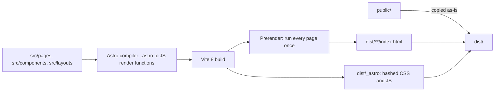

### 1.1 The Problem Astro Solves

Over the last decade many teams built content sites (marketing pages, blogs, docs, storefront catalogues) with single-page-application tooling. The page arrives as HTML, then the browser downloads a JavaScript bundle that re-renders the same tree to attach event handlers. That second pass is hydration, and on a content page most of it is wasted work: the article text, the footer and the navigation links never change after load.

The cost shows up in Core Web Vitals:

- **Interaction to Next Paint (INP)**: a long hydration task keeps the main thread busy, so the first tap waits.
- **Largest Contentful Paint (LCP)**: render-blocking scripts and large bundles delay the hero image or headline.
- **Total Blocking Time (TBT)** in lab tools: every kilobyte of JavaScript has to be parsed, compiled and executed, which is slowest on low-end Android phones.

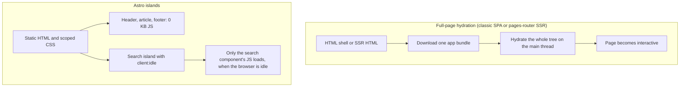

React Server Components and partial hydration in other frameworks attack the same problem. Astro's difference is the default: a component ships no JavaScript unless you ask for it, and the page has no client-side router or framework runtime unless an island needs one.

### 1.2 HTML-First Rendering & Opt-In Hydration

Astro reverses the SPA model with three rules:

1. **Server-rendered HTML.** Every `.astro` component compiles to a function that returns HTML. The function runs at build time (static output) or per request (on-demand rendering). It never runs in the browser, so no JavaScript for it is sent.
2. **Component islands.** Interactive parts of the page are isolated islands. Each island loads its own JavaScript, on its own schedule, without waiting for the rest of the page.
3. **Bring your own framework.** Islands can be React, Preact, Vue, Svelte, Solid or a plain custom element. Astro does not have its own client-side reactivity model; it renders framework components to HTML on the server and hydrates the ones you mark.

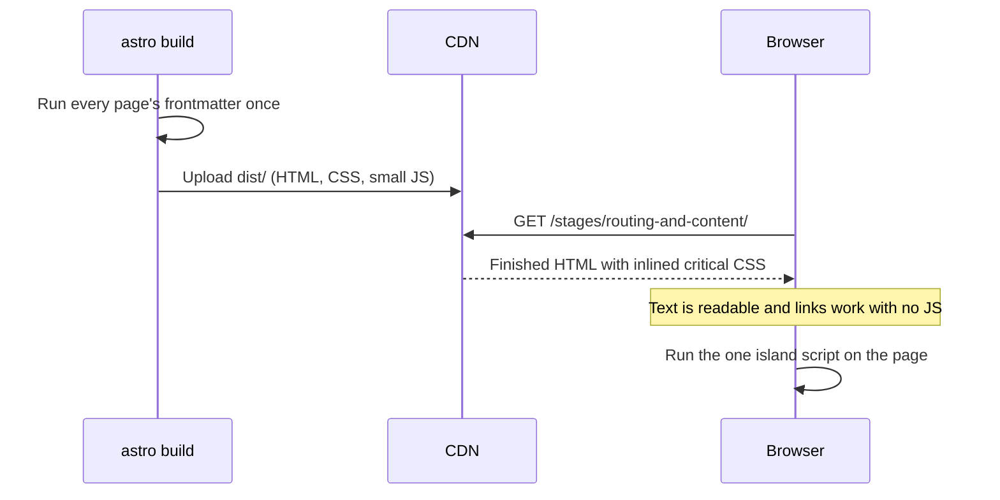

The starter project's home page shows both halves. The frontmatter computes a build date, which is baked into the HTML:

```astro
---
// src/pages/index.astro (excerpt)
import { stages } from '../lib/curriculum';

// Runs once, at build time. Nothing in this fence reaches the browser.
const builtAt = new Date().toISOString().slice(0, 10);
---
<p class="built">Built on {builtAt}</p>
```

The counter on the same page is an island: a custom element plus a bundled `<script>`. Stage 3 dissects it.

### 1.3 Astro Compared with Other Frameworks

| Concern | Astro | Next.js (App Router) | SvelteKit / Nuxt | Eleventy / Hugo |
| --- | --- | --- | --- | --- |
| Default JavaScript per page | None | React runtime plus client components | Framework runtime plus router | None |
| Interactivity model | Islands, any framework | React client components inside a server tree | One framework, full hydration by default | Hand-written scripts |
| Client-side routing | Opt-in `<ClientRouter />` (view transitions) | Built-in | Built-in | None |
| Content pipeline | Content collections with typed schemas and loaders | Bring your own (MDX, CMS SDK) | Bring your own or modules | Templates and data files |
| Rendering modes | Static by default, per-route on-demand, server islands | Static, dynamic, streaming, partial prerendering | Static, SSR, per-route options | Static only |
| Best fit | Content-heavy sites with pockets of interactivity | Highly interactive apps that are mostly React | Apps in one framework | Pure static sites |

Pick Astro when most of each page is read, not manipulated. Pick an app framework when most of each page reacts to client state (an editor, a dashboard with live filters everywhere, a chat client).

### 1.4 Installation & First Run

`create-astro` scaffolds a project from a template. All flags are optional; without them the CLI asks.

```bash
# Check the runtime first. Astro 7.4 needs Node.js 22.23.4 or newer.
node -v

# Scaffold the minimal template without prompts.
npm create astro@latest my-site -- --template minimal --install --git --yes
cd my-site

npm run dev          # http://localhost:4321 with hot module replacement
npm run build        # writes dist/
npm run preview      # serves dist/ locally to check the production build
```

To work on this guide's starter instead:

```bash
git clone https://github.com/TheLearningHubOrg/learn-astro.git
cd learn-astro
npm ci               # installs exactly what package-lock.json pins
npm run dev
npm test             # Vitest: library tests and Container API component tests
npm run lint         # astro check: type-checks .astro and .ts files
```

`npm ci` refuses to run when `package.json` and `package-lock.json` disagree, which is what you want in CI and Docker.

### 1.5 Project Anatomy of the Starter

```text
learn-astro/
├── astro.config.mjs          # Astro configuration (ESM only since 6.0)
├── tsconfig.json             # extends astro/tsconfigs/strict
├── vitest.config.ts          # getViteConfig() so tests can import .astro files
├── public/                   # copied to dist/ unchanged: favicon.svg, bmc-button.svg
├── src/
│   ├── components/           # Card, Counter (island), StageNav, DirectiveTable
│   ├── layouts/Layout.astro  # <html> shell shared by every page
│   ├── lib/                  # plain TypeScript: curriculum data, hydration rules, counter logic
│   ├── pages/                # file-based routes
│   │   ├── index.astro       # /
│   │   ├── islands.astro     # /islands/
│   │   ├── 404.astro         # /404.html
│   │   ├── stages.json.ts    # /stages.json (static endpoint)
│   │   └── stages/[slug].astro  # /stages/<slug>/ for each stage
│   └── styles/global.css     # imported once by the layout
├── test/                     # Vitest suites
├── docker/nginx.conf         # runtime web server config
└── Dockerfile                # node build stage, nginx runtime stage
```

| Path | Rule | Consequence |
| --- | --- | --- |
| `src/pages/` | Every `.astro`, `.md`, `.mdx`, `.html`, `.ts` or `.js` file is a route | Renaming a file changes a public URL |
| `src/pages/_draft.astro` | A leading underscore excludes a file from routing | Use it for page-local partials |
| `public/` | Served at the site root, never processed | No hashing, no optimisation; reference as `/favicon.svg` |
| `src/assets/` (convention) | Imported files are processed by Vite | Images get optimised, files get content hashes |
| `src/lib/` | Not special to Astro | Plain modules that tests can import without a renderer |
| `.astro/` | Generated by `astro sync` and `astro dev` | Holds `types.d.ts`; ignored by git |

Keeping logic in `src/lib/` is a deliberate choice in the starter: `curriculum.ts`, `hydration.ts` and `counter.ts` are pure functions, so `test/curriculum.test.ts` and `test/hydration.test.ts` run them with no Astro machinery at all.

### 1.6 `astro.config.mjs` Line by Line

```js
// @ts-check
import { defineConfig } from 'astro/config';

// https://docs.astro.build/en/reference/configuration-reference/
export default defineConfig({
  // Every route is prerendered to HTML at build time. No adapter is needed.
  output: 'static',
  // /stages/routing/ is written as dist/stages/routing/index.html.
  build: { format: 'directory' },
  server: {
    port: 4321,
    // Listen on 0.0.0.0 so the dev server is reachable from a container or VM.
    host: true,
  },
});
```

| Line / API | Role | What happens at runtime |
| :--- | :--- | :--- |
| `// @ts-check` | Turns on TypeScript checking for this `.mjs` file | Editors flag misspelled options using `defineConfig`'s types |
| `defineConfig({...})` | Identity function with a typed parameter | Returns the object unchanged; exists for autocompletion |
| `output: 'static'` | Default rendering mode | Pages are rendered once during `astro build`; on-demand routes need an adapter |
| `build.format: 'directory'` | Output file naming | `about.astro` becomes `dist/about/index.html`; `'file'` would write `dist/about.html`; `'preserve'` mirrors the source path |
| `server.port` | Dev and preview port | `astro dev` and `astro preview` listen on 4321 |
| `server.host: true` | Bind address | Listens on all interfaces; the default `false` binds `localhost` only |

Options you will add in later stages: `site` (absolute URL used for sitemaps and canonical links), `base` (sub-path deployments), `integrations` (`astro add react`), `adapter` (Stage 6), `trailingSlash` (`'always'`, `'never'` or `'ignore'`), and `vite` for raw Vite configuration.

### 1.7 The CLI: `dev`, `build`, `preview`, `check`, `sync`, `add`

| Command | What it does | When to run it |
| --- | --- | --- |
| `astro dev` | Vite dev server with HMR, on-demand rendering of every page, dev toolbar | Local work. In 7.x, a detected coding agent starts it in the background; `astro dev stop` / `status` / `logs` manage it |
| `astro build` | Compiles, bundles, prerenders, writes `dist/` | CI and Docker. `--timings` (7.4) prints where build time went |
| `astro preview` | Serves `dist/` (or runs the adapter's server) | Before deploying, to test the real output |
| `astro check` | Type-checks `.astro`, `.ts` and content schemas through the Astro language server | CI lint step; needs `@astrojs/check` and `typescript` |
| `astro sync` | Generates `.astro/types.d.ts` for content collections, env schema and actions | After changing `content.config.ts` or in a postinstall step |
| `astro add <name>` | Installs an integration or adapter and edits the config | `astro add react`, `astro add node`, `astro add mdx` |
| `astro info` | Prints Astro, Node, package manager and integration versions | Paste into bug reports |
| `astro preferences` | Toggles dev toolbar and telemetry preferences | `astro preferences disable devToolbar` |

The starter wires these into npm scripts (`dev`, `build`, `preview`, `lint`, `test`) so CI never calls the binary directly.

### 1.8 What `astro build` Produces

Running `npm run build` on the starter prints one line per route and writes:

```text
dist/
├── 404.html
├── favicon.svg                         # from public/
├── bmc-button.svg                      # from public/
├── index.html
├── islands/index.html
├── stages.json                         # output of src/pages/stages.json.ts
└── stages/
    ├── setup-and-rendering-model/index.html
    ├── components-and-templates/index.html
    ├── islands-and-client-directives/index.html
    └── ... one folder per stage
```

There is no `_astro/` folder in this build, and that is worth understanding. Astro inlines small assets: stylesheets below the inlining threshold go into a `<style>` tag in `<head>` (`build.inlineStylesheets: 'auto'`), and the counter's processed script is small enough to be emitted as an inline `<script type="module">`. A larger site, or one with a framework island, gets hashed files under `dist/_astro/`, which the Dockerfile's nginx config caches for a year.

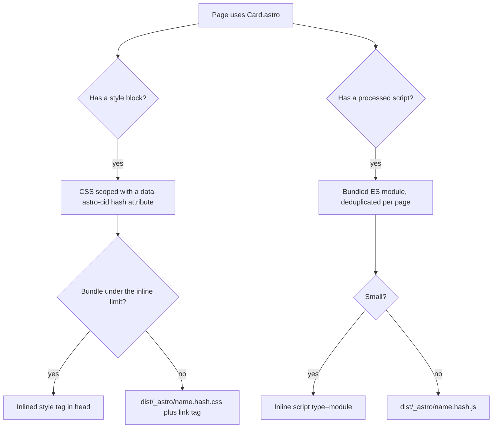

Open `dist/index.html` and search for `data-astro-cid-`. Each component with a `<style>` block gets one hash, added as an attribute to its elements and appended to its selectors (`.card[data-astro-cid-yk4hkwyg]`). That is how scoped styles work without Shadow DOM.

### 1.9 Pitfalls

| Pitfall | Symptom | Fix |
| --- | --- | --- |
| Node.js too old | `Node.js v22.16.0 is not supported by Astro!` and the CLI exits with code 1 | Install the version in `engines`; pin it in `.nvmrc` and CI |
| Using `npm install` in CI | Different transitive versions between runs, "works on my machine" builds | Commit `package-lock.json` and use `npm ci` |
| Referencing an image in `public/` through an import | Original, unoptimised file served; no hash, so CDN caches serve stale copies | Put processed assets in `src/assets/` and import them |
| Putting a `<script src="/x.js">` that points into `public/` in a component | Build error: `references an asset in the "public" directory. Please add the "is:inline" directive` | Add `is:inline`, or move the file into `src/` and import it |
| Running `astro dev` in production or Docker | Slow responses, HMR client in pages, dev toolbar visible | Serve `dist/` with nginx, or run the adapter's server entry |
| Binding the dev server to `localhost` in a container | `curl: (7) Failed to connect` from the host | `server.host: true` or `astro dev --host` |
| A CommonJS `astro.config.js` with `module.exports` | Config fails to load on 6.0 and later | Use ESM: `export default defineConfig({...})` |
| Expecting `dist/about.html` URLs | 404s after deploy on a server that does not map `/about` to `about/index.html` | Match `build.format` to the host, or configure `try_files $uri $uri/ $uri.html` as the starter's nginx does |

### 1.10 Best Practices

- **Start from `output: 'static'`**: you can opt single routes into on-demand rendering later, but you cannot easily take a server back out of a design.
- **Keep data and rules in `src/lib/` as plain TypeScript**: they are testable without a renderer and reusable from pages, endpoints and scripts.
- **Run `astro check` in CI**: it catches prop type errors inside templates that `tsc` alone cannot see.
- **Pin Node in three places** (`engines`, `.nvmrc`, CI matrix): the Astro CLI enforces its range, so drift breaks builds abruptly.
- **Preview the production build before deploying**: `astro dev` renders on demand and can hide prerender-only errors such as missing `getStaticPaths()` entries.
- **Read `dist/` after every structural change**: the HTML files are the product; knowing their paths prevents broken links and 404s.

### 1.11 Hands-on Exercise

Add an "About" page at `/about/` that shows the number of stages and links back to `/`.

1. Create `src/pages/about.astro` that imports `Layout` and `stages` from `src/lib/curriculum`.
2. Render `<h1>About</h1>` and `<p>{stages.length} stages</p>`.
3. Run `npm run build`.

**Expected output:** the build log lists `/about/index.html`, and `dist/about/index.html` contains `<p>7 stages</p>` with no `<script>` tag. The pattern to copy is `src/pages/404.astro`, which uses the same layout. Stretch: add the link to the navigation in `src/layouts/Layout.astro` and mark it with `aria-current` the way the existing links do.

[Back to top ⤴️](#-table-of-contents)

---

## 2. Stage 2: Astro Components, Templates, Props & Slots

This stage covers the `.astro` component format end to end: the frontmatter fence, typed props, template expressions, slots, layouts, scoped styles, a first dynamic route, a static endpoint, and component tests. It assumes Stage 1's project. Afterwards you can build a multi-page static site from reusable components and prove it renders correctly with Vitest.

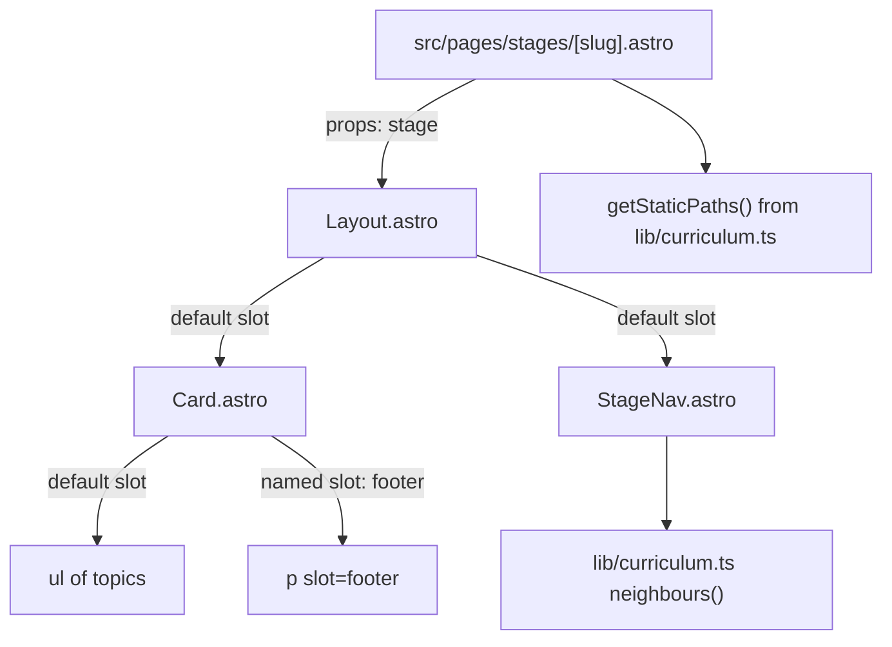

### 2.1 The Anatomy of an `.astro` File

An Astro component has two parts:

- **Component script**, between the `---` fences. It is TypeScript that runs on the server: at build time for prerendered pages, per request for on-demand pages. Imports, `fetch()`, database calls, file reads and secrets are all safe here because none of it is sent to the browser.
- **Component template**, everything after the closing fence. HTML plus `{expressions}`, other components, `<slot />`, and optional `<style>` and `<script>` blocks.

```astro
---
// src/components/SystemMetricCard.astro
// --- Component script: server only ---
interface Props {
  title: string;
  metricValue: number;
  unit: string;
  status: 'healthy' | 'degraded' | 'critical';
}

const { title, metricValue, unit, status } = Astro.props;

// Plain server logic. A lookup table is cheaper than branching in the template.
const statusLabel: Record<Props['status'], string> = {
  healthy: 'OK',
  degraded: 'Degraded',
  critical: 'Critical',
};
---

<!-- Component template: HTML plus expressions -->
<div class="metric-card" data-status={status}>
  <div class="row">
    <h3 class="metric-title">{title}</h3>
    <span class="badge">{statusLabel[status]}</span>
  </div>
  <p class="metric-display">
    <span class="value">{metricValue}</span>
    <span class="unit">{unit}</span>
  </p>
  <slot name="footer" />
</div>

<style>
  /* Scoped automatically to this component only */
  .metric-card {
    padding: 1.5rem;
    border-radius: 0.75rem;
    background: #111827;
    border: 1px solid #1f2937;
  }
  .row {
    display: flex;
    justify-content: space-between;
    align-items: center;
  }
  .metric-title {
    font-size: 0.875rem;
    color: #9ca3af;
    margin: 0;
  }
  .badge {
    font-size: 0.75rem;
    padding: 0.1rem 0.5rem;
    border-radius: 9999px;
  }
  [data-status='healthy'] .badge { background: #064e3b; color: #6ee7b7; }
  [data-status='degraded'] .badge { background: #78350f; color: #fcd34d; }
  [data-status='critical'] .badge { background: #7f1d1d; color: #fca5a5; }
  .metric-display {
    margin-top: 1rem;
    display: flex;
    align-items: baseline;
    gap: 0.25rem;
  }
  .value {
    font-size: 2rem;
    font-weight: 700;
    color: #f9fafb;
  }
  .unit {
    color: #6b7280;
    font-size: 0.875rem;
  }
</style>
```

Styling by a `data-status` attribute keeps the state in the markup, so CSS, tests and future scripts all read the same source of truth.

| Part | Runs where | Can use | Cannot use |
| --- | --- | --- | --- |
| Frontmatter | Node (or the adapter's runtime) | `fetch`, `fs`, env secrets, top-level `await` | `window`, `document`, event listeners |
| Template expressions | Same place, during rendering | Any value from the frontmatter, Promises (awaited) | Event handlers like `onClick={fn}` (functions are not serialised to HTML) |
| `<style>` | Compiled to CSS at build | Nesting, `:global()`, `define:vars` | Runtime values except through `define:vars` |
| `<script>` | Browser | DOM APIs, imports from `src/` and npm | Frontmatter variables, unless passed through `data-*` attributes |

### 2.2 Typed Props

The starter's `Card.astro` is the reference component for props, defaults and slots:

```astro
---
interface Props {
  title: string;
  stage: string;
  description: string;
  badge?: string;
  href?: string;
}

const { title, stage, description, badge = 'Core', href } = Astro.props;
// Astro.slots.has() tells you whether the parent passed content for a slot.
const hasFooter = Astro.slots.has('footer');
---

<article class="card">
  <header>
    <span class="stage">{stage}</span>
    <span class="badge">{badge}</span>
  </header>
  <h3>
    {href ? <a href={href}>{title}</a> : title}
  </h3>
  <p>{description}</p>
  <slot />
  {hasFooter && (
    <footer>
      <slot name="footer" />
    </footer>
  )}
</article>
```

| Line / API | Role | What happens at runtime |
| :--- | :--- | :--- |
| `interface Props` | Declares the component's inputs | `astro check` and the editor validate every `<Card ...>` usage against it |
| `Astro.props` | The attributes the parent passed | A plain object; destructuring gives you local constants |
| `badge = 'Core'` | Default value | Used when the parent omits `badge` or passes `undefined` |
| `href ? <a> : title` | Conditional markup | Only one branch is rendered into the HTML |
| `<slot />` | Default slot | Replaced by the children the parent placed between `<Card>` tags |
| `Astro.slots.has('footer')` | Slot presence check | Lets the card skip the `<footer>` wrapper when nothing would go in it |

To accept arbitrary HTML attributes, extend the built-in types and spread the rest:

```astro
---
// src/components/Button.astro
import type { HTMLAttributes } from 'astro/types';

interface Props extends HTMLAttributes<'button'> {
  variant?: 'primary' | 'ghost';
}

const { variant = 'ghost', class: className, ...rest } = Astro.props;
---
<button class:list={['btn', variant, className]} {...rest}>
  <slot />
</button>
```

`class` is a reserved word in JavaScript, so it is renamed during destructuring. Spreading `rest` forwards `type`, `aria-*`, `data-*` and, importantly, the parent's scoped-style attribute (see 2.6). To reuse a component's prop type elsewhere, use `ComponentProps<typeof Card>` from `astro/types`.

### 2.3 Template Expressions

Astro templates look like JSX but produce HTML strings, not a virtual DOM. Everything you interpolate is HTML-escaped unless you opt out.

```astro
---
import { stages } from '../lib/curriculum';

const featured = stages.slice(0, 3);
const isDraft = false;
const level: 'h2' | 'h3' = 'h2';
const Heading = level;                       // dynamic tag: variable must start with a capital letter
const rawHtml = '<strong>trusted</strong>';  // only ever from a trusted source
---

<Heading>Featured stages</Heading>

<!-- Lists: map returns markup -->
<ul>
  {featured.map((s) => <li data-stage={s.number}>{s.title}</li>)}
</ul>

<!-- Conditionals: && or a ternary -->
{isDraft && <p class="warning">Draft</p>}
{featured.length > 0 ? <p>{featured.length} featured</p> : <p>None yet</p>}

<!-- Several root nodes without a wrapper -->
<>
  <dt>Stages</dt>
  <dd>{stages.length}</dd>
</>

<!-- class:list accepts strings, arrays and objects, and drops falsy values -->
<p class:list={['note', { draft: isDraft, ready: !isDraft }]}>Status</p>

<!-- set:html skips escaping. Never pass user input to it. -->
<Fragment set:html={rawHtml} />

<!-- Promises are awaited during rendering -->
<p>{Promise.resolve('Resolved on the server')}</p>
```

Two 7.x details matter here. First, `compressHTML: 'jsx'` removes line breaks between elements, so `<span>a</span>` on one line and `<span>b</span>` on the next renders as `ab`; add `{' '}` where you need the space. Second, the Rust compiler rejects invalid nesting that the Go compiler used to repair, so close every element you open.

| Need | Write | Not |
| --- | --- | --- |
| Loop | `{items.map((i) => <li>{i}</li>)}` | `for` statements in the template |
| Optional attribute | `aria-current={active ? 'page' : undefined}` | `aria-current={active && 'page'}` (renders `aria-current="false"` when `false`) |
| Boolean attribute | `disabled={isDisabled}` | `disabled="false"` (still disabled) |
| Raw HTML | `<Fragment set:html={html} />` | `{html}` (escaped, shows tags as text) |
| Text without escaping risk | `<p set:text={value} />` or `{value}` | `set:html` with untrusted input |

### 2.4 Slots: Default, Named, Fallback

Slots let a parent pass markup into a child.

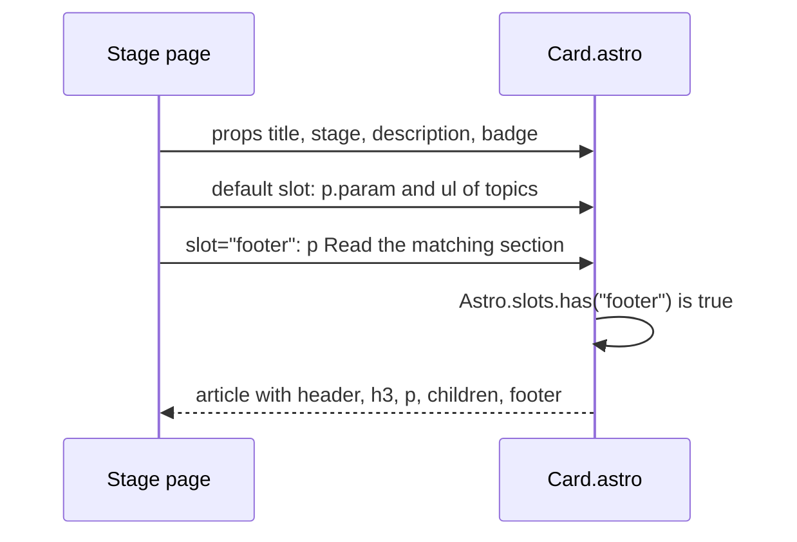

```astro
---
// src/components/Panel.astro
const hasActions = Astro.slots.has('actions');
---
<section class="panel">
  <h2><slot name="title">Untitled panel</slot></h2>   <!-- fallback content -->
  <slot />                                           <!-- default slot -->
  {hasActions && <div class="actions"><slot name="actions" /></div>}
</section>
```

```astro
---
// Using Panel
import Panel from '../components/Panel.astro';
---
<Panel>
  <span slot="title">Build status</span>
  <p>All checks passed.</p>
  <a slot="actions" href="/runs/">View runs</a>
</Panel>
```

| Feature | Syntax | Notes |
| --- | --- | --- |
| Default slot | `<slot />` | Receives every child without a `slot` attribute |
| Named slot | `<slot name="x" />` + `<el slot="x">` | The `slot` attribute is removed from the output |
| Fallback | `<slot name="x">fallback</slot>` | Rendered only when the parent passes nothing for `x` |
| Several elements into one named slot | `<Fragment slot="x">...</Fragment>` | Avoids an extra wrapper element |
| Forwarding a slot | `<slot name="x" slot="x" />` inside the middle component | Passes a grandparent's slot through to a grandchild |
| Presence check | `Astro.slots.has('x')` | Use it to skip wrappers and borders |
| Render to a string | `await Astro.slots.render('x')` | Lets you post-process slot HTML or call a function slot with arguments |

### 2.5 Layouts and the Page Shell

A layout is an ordinary component that renders `<html>` and a slot. The starter has one:

```astro
---
import '../styles/global.css';

interface Props {
  title: string;
  description?: string;
}

const { title, description = 'Learn Astro with The Learning Hub' } = Astro.props;
// Astro.url is the URL of the page being rendered (at build time for static pages).
const path = Astro.url.pathname;
---

<!doctype html>
<html lang="en">
  <head>
    <meta charset="UTF-8" />
    <meta name="viewport" content="width=device-width, initial-scale=1.0" />
    <meta name="description" content={description} />
    <link rel="icon" type="image/svg+xml" href="/favicon.svg" />
    <title>{title}</title>
  </head>
  <body>
    <nav class="site-nav" aria-label="Main">
      <a href="/" aria-current={path === '/' ? 'page' : undefined}>Home</a>
      <a href="/islands/" aria-current={path.startsWith('/islands') ? 'page' : undefined}>Islands</a>
      <a href="/stages.json">stages.json</a>
    </nav>
    <main>
      <slot />
    </main>
    <footer>
      <p>&copy; {new Date().getFullYear()} The Learning Hub &bull; Built with Astro</p>
    </footer>
  </body>
</html>
```

| Line / API | Role | What happens at runtime |
| :--- | :--- | :--- |
| `import '../styles/global.css'` | Global stylesheet | Bundled once; inlined or linked in every page that uses the layout |
| `Astro.url.pathname` | Current route | At build time it is the path being prerendered, so `aria-current` is computed with no client JS |
| `<!doctype html>` | Document type | Must be the first output; layouts are the right place for it |
| `<title>{title}</title>` | Per-page title | Each page passes its own `title` prop |
| `<slot />` in `<main>` | Page content | The page's markup is inserted here |

Pages compose layouts by wrapping their content: `<Layout title="Islands | Learn Astro">...</Layout>`. Nest layouts (a `DocsLayout` that renders `Layout` and adds a sidebar) instead of growing one layout with flags.

### 2.6 Styling: Scoped, Global, and Dynamic

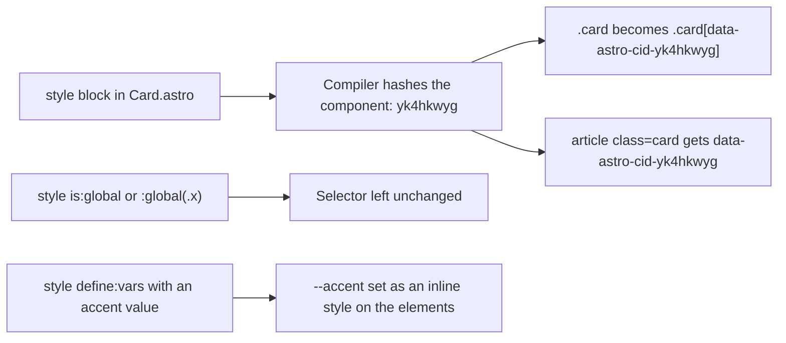

| Technique | Syntax | Effect |
| --- | --- | --- |
| Scoped (default) | `<style>.card {}</style>` | Selector rewritten with the component's `data-astro-cid-*` attribute; cannot leak out |
| One global selector | `:global(.prose a) {}` | Escapes scoping for that selector only |
| Whole block global | `<style is:global>` | No rewriting at all; use sparingly, prefer a global CSS file |
| Global stylesheet | `import '../styles/global.css'` in a layout | Shared tokens, resets, typography |
| Runtime values | `<style define:vars={{ accent }}>` then `color: var(--accent)` | Frontmatter values become CSS custom properties |
| Child component styling | Pass `class`, child spreads `{...rest}` onto its root | The parent's scope attribute travels with the props |
| CSS Modules, Sass, PostCSS, Tailwind | `import styles from './x.module.css'`, `<style lang="scss">`, `@tailwindcss/vite` | Handled by Vite; Sass needs the `sass` package |

The child-component row is the usual surprise. A parent's scoped rule `.highlight { ... }` targets `.highlight[data-astro-cid-PARENT]`. When the parent writes `<Button class="highlight">`, Astro passes both `class` and the parent's `data-astro-cid-PARENT` as props. If `Button.astro` only reads `class` and does not spread the rest, the attribute is lost and the rule never matches.

### 2.7 Your First Dynamic Route with `getStaticPaths()`

A file name in brackets is a route parameter. In static output Astro must know every value at build time, so the page exports `getStaticPaths()`.

```astro
---
import type { GetStaticPaths } from 'astro';
import Layout from '../../layouts/Layout.astro';
import Card from '../../components/Card.astro';
import StageNav from '../../components/StageNav.astro';
import { stagePaths, type Stage } from '../../lib/curriculum';

// Static output: Astro calls this once at build time and writes one HTML file
// per returned entry, e.g. dist/stages/setup-and-rendering-model/index.html.
export const getStaticPaths = (() => stagePaths()) satisfies GetStaticPaths;

interface Props {
  stage: Stage;
}

const { stage } = Astro.props;
const { slug } = Astro.params;
---

<Layout title={`Stage ${stage.number}: ${stage.title}`} description={stage.summary}>
  <Card stage={`Stage ${stage.number}`} title={stage.title} description={stage.summary} badge="Stage page">
    <p class="param">Route parameter: <code>{slug}</code></p>
    <ul>
      {stage.topics.map((t) => <li><code>{t}</code></li>)}
    </ul>
    <p slot="footer">Read the matching section in the README.</p>
  </Card>
  <StageNav slug={stage.slug} />
</Layout>
```

```ts
// src/lib/curriculum.ts (excerpt)
export function stagePaths() {
  return stages.map((s) => ({ params: { slug: s.slug }, props: { stage: s } }));
}
```

| Line / API | Role | What happens at runtime |
| :--- | :--- | :--- |
| `[slug].astro` | Route pattern `/stages/:slug/` | One HTML file per `slug` value |
| `getStaticPaths()` | Enumerates parameter values | Called once per build, before any page in this file renders |
| `params: { slug }` | URL segment values | Must be strings (or `undefined` for rest params); numbers are rejected since 6.0 |
| `props: { stage }` | Data handed to that page | Avoids looking the stage up again; becomes `Astro.props.stage` |
| `satisfies GetStaticPaths` | Type check without widening | Keeps the inferred return type, so `Astro.props` is typed |
| `Astro.params.slug` | The parameter for this render | Same value as in `params` |

Rest parameters (`[...path].astro`) match several segments, and `undefined` matches the bare directory. Stage 4 covers pagination, rest routes and content-driven routes.

### 2.8 Static Endpoints

A `.ts` file in `src/pages/` that exports HTTP-method functions is an endpoint. In static output, `GET` runs at build time and its body is written to disk, named after the file minus `.ts`:

```ts
// src/pages/stages.json.ts
import type { APIRoute } from 'astro';
import { stages } from '../lib/curriculum';

// In static output this endpoint runs at build time and is written to
// dist/stages.json. With an adapter and `prerender = false` it would run per request.
export const GET: APIRoute = () =>
  Response.json(stages.map(({ number, slug, title }) => ({ number, slug, title, url: `/stages/${slug}/` })));
```

`Response.json()` sets `content-type: application/json`. Static endpoints are useful for search indexes, RSS feeds (`rss.xml.ts`), `robots.txt.ts`, and JSON that islands fetch. A dynamic endpoint (`[id].json.ts`) also needs `getStaticPaths()` in static output.

### 2.9 Testing Components with the Container API

The Container API renders a component to a string outside a running site. Combined with `getViteConfig()`, Vitest can import `.astro` files directly.

```ts
// vitest.config.ts
/// <reference types="vitest/config" />
import { getViteConfig } from 'astro/config';

export default getViteConfig({
  test: {
    include: ['test/**/*.test.ts'],
    environment: 'node',
  },
});
```

```ts
// test/components.test.ts (excerpt)
import { experimental_AstroContainer as AstroContainer } from 'astro/container';
import { beforeAll, describe, expect, it } from 'vitest';
import Card from '../src/components/Card.astro';
import StagePage from '../src/pages/stages/[slug].astro';
import { stages } from '../src/lib/curriculum';

let container: AstroContainer;

beforeAll(async () => {
  container = await AstroContainer.create();
});

describe('Card.astro', () => {
  it('renders default and named slots', async () => {
    const html = await container.renderToString(Card, {
      props: { title: 'Slots', stage: 'Stage 2', description: 'x' },
      slots: { default: '<em>body</em>', footer: 'footnote' },
    });
    expect(html).toContain('<em>body</em>');
    expect(html).toMatch(/<footer[^>]*>[\s\S]*footnote[\s\S]*<\/footer>/);
  });
});

describe('stages/[slug].astro', () => {
  it('renders a full page for one stage', async () => {
    const stage = stages[2];
    const html = await container.renderToString(StagePage, {
      props: { stage },
      params: { slug: stage.slug },
      partial: false,
    });
    expect(html).toMatch(/^<!DOCTYPE html>/i);
    expect(html).toContain(`<title>Stage 3: ${stage.title}</title>`);
  });
});
```

| Option | Purpose |
| --- | --- |
| `props` | Becomes `Astro.props` |
| `slots` | `{ default: '...', name: '...' }`, strings of HTML |
| `params` | Becomes `Astro.params` for dynamic routes |
| `request` | A `Request`, for components that read `Astro.url` or headers |
| `locals` | Becomes `Astro.locals`, to stand in for middleware |
| `partial: false` | Render as a full page, including `<!DOCTYPE html>` |

Since 6.0, `.astro` components can only be rendered in a server (Node) test environment, which is why the config sets `environment: 'node'`. The starter's suite has 25 tests across three files and runs in a few seconds.

### 2.10 Pitfalls

| Pitfall | Symptom | Fix |
| --- | --- | --- |
| Using `window` or `document` in frontmatter | `ReferenceError: document is not defined` during build | Move the code into a `<script>` or an island |
| Passing an event handler prop to an Astro element | `onClick={fn}` does nothing; the function is not in the HTML | Use a `<script>` with `addEventListener`, or a framework island |
| A dynamic route with no `getStaticPaths()` | `getStaticPaths() function is required for dynamic routes. Make sure that you export a getStaticPaths() function from your dynamic route.` | Export it, or set `export const prerender = false` with an adapter |
| Returning a number as a route param | `Invalid getStaticPaths() route parameter for slug. Expected a string or undefined, received number` | `String(id)` in `params` |
| Using `Astro` inside `getStaticPaths()` | Deprecation warning on 6.x; values such as `Astro.url` are not meaningful there | Compute everything from imports and arguments |
| Rendering untrusted text with `set:html` | Stored XSS | Use `{value}` or `set:text`; sanitise if HTML is required |
| Parent class styles not applied to a child component | Scoped rule present in CSS but never matches | Child spreads `{...rest}` onto its root element |
| Words joined after upgrading to 7.x | `AdaLovelace` instead of `Ada Lovelace` | `{' '}` between inline elements, or `compressHTML: true` |
| Testing `.astro` in `jsdom` or `happy-dom` | Errors importing or rendering the component | Use `environment: 'node'` and the Container API |

### 2.11 Best Practices

- **Declare `interface Props` in every component**: `astro check` then validates each usage, which is the only type safety templates get.
- **Default optional props in destructuring**: the template stays free of `?? 'fallback'` noise.
- **Use `Astro.slots.has()` before rendering wrappers**: empty borders and headings are a common visual bug.
- **Keep layouts thin and nest them**: one `Layout` for `<html>`, then section layouts that add chrome.
- **Prefer scoped styles plus a small global token file**: scoping prevents cascade collisions as the component count grows.
- **Put `getStaticPaths()` data logic in `src/lib/`**: it becomes unit-testable, as `stagePaths()` is in `test/curriculum.test.ts`.
- **Test components with the Container API in CI**: rendering tests catch broken slots and props that type checks miss.

### 2.12 Hands-on Exercise

Build a `Badge.astro` component and a `/topics/[topic]/` route.

1. `src/components/Badge.astro` takes `label: string` and `tone?: 'info' | 'warn'` (default `'info'`), renders `<span class:list={['badge', tone]}>`, and has scoped styles for both tones.
2. `src/pages/topics/[topic].astro` uses `getStaticPaths()` to emit one page per unique topic across all stages (slugify each topic with `slugify()` from `src/lib/curriculum.ts`), and lists the stages that include it.
3. Add a Container API test that renders `Badge` with `tone: 'warn'` and asserts the class list.

**Expected output:** `npm run build` lists one `/topics/<slug>/index.html` per topic (about 25), and `npm test` reports one more passing test. The patterns to copy are `src/components/Card.astro`, `src/pages/stages/[slug].astro` and `test/components.test.ts`.

[Back to top ⤴️](#-table-of-contents)

---

## 3. Stage 3: Islands, Client Directives & Client-Side State

This stage adds interactivity without giving up the zero-JavaScript baseline. It covers client directives and their options, what `<astro-island>` does in the browser, processed and inline scripts, the starter's custom-element island, framework integrations, prop serialisation, and shared state with Nanostores. It assumes Stages 1 and 2. Afterwards you can decide, per component, whether it ships JavaScript and when that JavaScript loads.

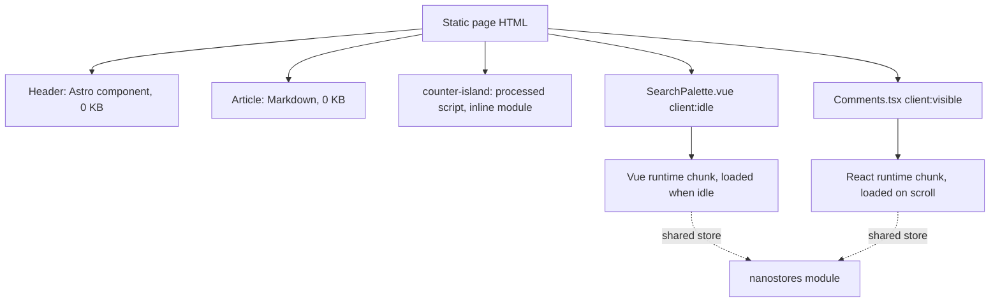

### 3.1 Islands Architecture

An island is a component that the server renders to HTML and the browser then hydrates on its own. The rest of the page stays static HTML. Three properties follow from that:

1. **Independent loading.** Each island has its own trigger. A slow comments widget at the bottom of the page does not delay a menu button at the top.
2. **Independent failure.** If one island throws during hydration, the others still work, and the static content was already visible.
3. **Framework per island.** One page can mix a React island and a Svelte island; each loads only its own renderer.

Astro components (`.astro`) never hydrate. They are templates, and their output is HTML. Interactivity comes from two places: a `<script>` tag in an Astro component, or a UI framework component with a `client:*` directive.

### 3.2 Client Directives

Directives apply to framework components only (React, Preact, Vue, Svelte, Solid, Alpine via its integration). Without a directive, a framework component is rendered to HTML on the server and ships no JavaScript.

| Directive | Loading trigger | Typical use | Performance impact |
| :--- | :--- | :--- | :---: |
| *(none)* | Never; server render only | Presentational components, static cards | 0 KB JS |
| `client:load` | Immediately when the page's scripts run | Primary navigation toggle, add-to-cart on a product page | Competes with first render; keep small |
| `client:idle` | `requestIdleCallback`, or a 200 ms timeout where it is unsupported | Search box, chat launcher, newsletter form | Avoids blocking first paint and LCP |
| `client:visible` | `IntersectionObserver` reports the island on screen | Comments, pricing calculator, carousels below the fold | Never downloads if the user never scrolls there |
| `client:media="(query)"` | `window.matchMedia(query)` matches | Mobile-only bottom sheet, desktop-only sidebar | Devices that never match never download it |
| `client:only="react"` | On load, with no server render | Components that touch `window` or `localStorage` while rendering | No HTML until JS runs; reserve space to avoid layout shift |

Two directives take options:

```astro
---
import Search from '../components/Search.tsx';
import Comments from '../components/Comments.tsx';
---
<!-- Give up waiting for idle time after 500 ms. -->
<Search client:idle={{ timeout: 500 }} />

<!-- Start loading 200px before the island scrolls into view, so it is ready on arrival. -->
<Comments client:visible={{ rootMargin: '200px' }} postId="42" />
```

The starter encodes the selection rule as a pure function, so the reasoning is testable:

```ts
// src/lib/hydration.ts (excerpt)
export function chooseDirective(needs: IslandNeeds): Directive {
  if (!needs.interactive) return 'none';
  if (needs.browserOnly) return 'client:only';
  if (needs.media) return 'client:media';
  if (needs.aboveFold && needs.critical) return 'client:load';
  if (needs.aboveFold) return 'client:idle';
  return 'client:visible';
}
```

The order of the checks is the rule: static first, then hard constraints (browser-only, media), then the latest trigger that still feels instant. `test/hydration.test.ts` pins each branch. `src/components/DirectiveTable.astro` renders the same data on `/islands/`.

### 3.3 How Hydration Works: Inside the astro-island Element

When a page contains a framework component with a directive, the server output wraps it in a custom element:

```html
<astro-island
  uid="Z1abc"
  component-url="/_astro/Comments.Bx7.js"
  component-export="default"
  renderer-url="/_astro/client.D3k.js"
  props='{"postId":[0,"42"]}'
  ssr
  client="visible"
  opts='{"name":"Comments","value":{"rootMargin":"200px"}}'
>
  <!-- server-rendered HTML of Comments goes here -->
</astro-island>
```

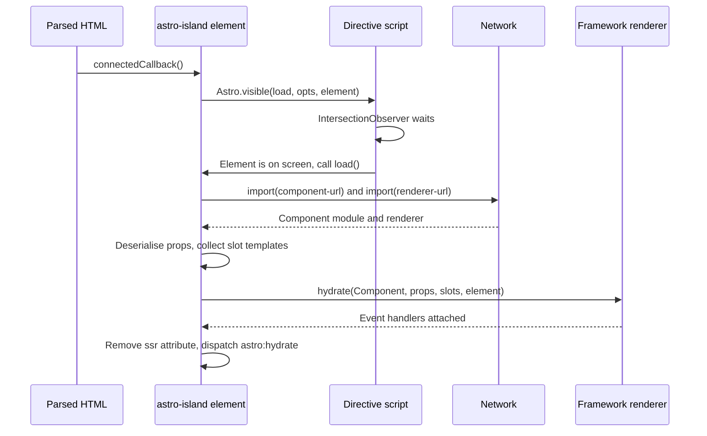

| Attribute | Meaning |
| --- | --- |
| `component-url` / `component-export` | Which module and export to import |
| `renderer-url` | The framework's client entry (React's `hydrateRoot` wrapper, Vue's `createSSRApp`, and so on) |
| `props` | Serialised props. Each value is a `[type, value]` pair so that `Date`, `Map`, `Set`, `URL`, `BigInt`, `RegExp`, typed arrays and `Infinity` survive the trip |
| `ssr` | Present while the HTML is server-rendered and not yet hydrated; removed afterwards, so `astro-island[ssr]` is a CSS hook for "not interactive yet" |
| `client` / `opts` | Which directive and its options |

The `astro-island` definition and each used directive's loader are small inline scripts emitted once per page, not per island. A nested island waits for its parent island to hydrate before hydrating itself.

### 3.4 Adding a Framework Integration

`astro add` installs the integration and its peer packages and edits the config:

```bash
npx astro add react        # @astrojs/react, react, react-dom, types
npx astro add svelte vue   # several at once
```

```js
// astro.config.mjs after `astro add react svelte`
import { defineConfig } from 'astro/config';
import react from '@astrojs/react';
import svelte from '@astrojs/svelte';

export default defineConfig({
  integrations: [react(), svelte()],
});
```

A page can then compose islands from several frameworks:

```astro
---
// src/pages/dashboard.astro
import Layout from '../layouts/Layout.astro';
import StaticOverview from '../components/StaticOverview.astro';     // Astro: 0 KB JS
import LiveTelemetryChart from '../components/react/LiveTelemetryChart'; // React
import SearchPalette from '../components/vue/SearchPalette.vue';        // Vue
import FeedbackWidget from '../components/svelte/FeedbackWidget.svelte'; // Svelte
---

<Layout title="Infrastructure Monitoring">
  <!-- 1. Static HTML rendered on the server -->
  <StaticOverview />

  <!-- 2. Above the fold and central to the page: hydrate immediately -->
  <LiveTelemetryChart client:load initialMetrics={[]} />

  <!-- 3. Search: wait until the main thread is idle -->
  <SearchPalette client:idle />

  <!-- 4. Feedback: load only when the user scrolls to it -->
  <FeedbackWidget client:visible />
</Layout>
```

Children work in one direction. A framework island can receive Astro content as children or named slots (it arrives as static HTML), but a `.tsx` or `.svelte` file cannot import an `.astro` component.

```astro
---
import Tabs from '../components/react/Tabs';
import Pricing from '../components/Pricing.astro';
---
<Tabs client:visible>
  <Pricing />                       <!-- default children: static HTML -->
  <p slot="footer">Prices in USD</p> <!-- React receives it as the `footer` prop -->
</Tabs>
```

### 3.5 Scripts in Astro Components: Processed vs `is:inline`

A plain `<script>` in an `.astro` file is processed: Vite bundles it as an ES module, resolves imports from `src/` and npm, compiles TypeScript, and includes it once per page no matter how many times the component appears.

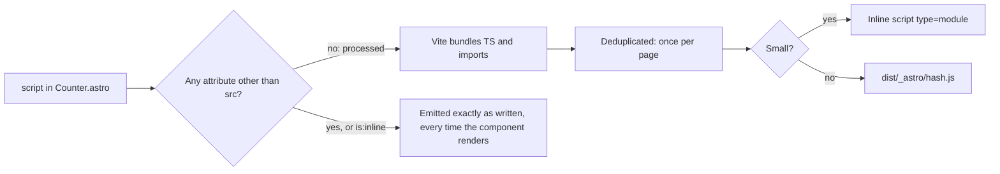

| Behaviour | Processed `<script>` | `<script is:inline>` |
| --- | --- | --- |
| TypeScript | Compiled | Not compiled; must be valid browser JS |
| `import` from npm or `src/` | Resolved and bundled | Only full URLs or `public/` paths |
| Repeated components | One copy per page | One copy per component instance |
| Execution | `type="module"`: deferred, strict mode | Classic script unless you add `type="module"` |
| Frontmatter values | Not available; pass via `data-*` | `define:vars={{ x }}` works (and implies `is:inline`) |
| Use for | Island logic, analytics wrappers | Theme scripts that must run before paint, third-party snippets |

Since 5.0, scripts render where you write them rather than being hoisted into `<head>`, and since 6.0 `<script>` and `<style>` tags keep their source order.

### 3.6 The Starter's Vanilla Island Line by Line

`src/components/Counter.astro` is an island with no framework. The server renders real markup, and a custom element upgrades it in place.

```astro
---
interface Props {
  label: string;
  start?: number;
  min?: number;
  max?: number;
}

const { label, start = 0, min, max } = Astro.props;
// The server renders real markup with the starting value, so the counter is
// readable before any JavaScript runs. The script below upgrades it in place.
---

<counter-island data-start={start} data-min={min} data-max={max}>
  <p class="label">{label}</p>
  <output aria-live="polite">{start}</output>
  <div class="buttons">
    <button type="button" data-step="-1">-1</button>
    <button type="button" data-reset>Reset</button>
    <button type="button" data-step="1" class="primary">+1</button>
  </div>
</counter-island>

<script>
  // Astro bundles this script as an ES module and includes it once per page,
  // however many <Counter> instances the page renders.
  import { nextCount, type CounterOptions } from '../lib/counter';

  const toNumber = (value: string | undefined) => (value === undefined ? undefined : Number(value));

  class CounterIsland extends HTMLElement {
    connectedCallback() {
      const options: CounterOptions = {
        start: Number(this.dataset.start ?? 0),
        min: toNumber(this.dataset.min),
        max: toNumber(this.dataset.max),
      };
      const output = this.querySelector('output');
      let value = options.start;

      this.addEventListener('click', (event) => {
        const button = (event.target as Element).closest('button');
        if (!button || !output) return;
        value = button.hasAttribute('data-reset')
          ? nextCount(value, { type: 'reset' }, options)
          : nextCount(value, { type: 'step', by: Number(button.dataset.step) }, options);
        output.textContent = String(value);
      });
    }
  }

  if (!customElements.get('counter-island')) {
    customElements.define('counter-island', CounterIsland);
  }
</script>
```

| Line / API | Role | What happens at runtime |
| :--- | :--- | :--- |
| `data-min={min}` | Passes server values to the script | `undefined` drops the attribute entirely, so `dataset.min` is `undefined` (the test asserts this) |
| `<output aria-live="polite">` | Result element | Screen readers announce changes without stealing focus |
| `import { nextCount }` | Script imports a `src/lib` module | Bundled into the page's module; the same function is unit-tested in Node |
| `class CounterIsland extends HTMLElement` | Custom element | The browser calls `connectedCallback()` for every `<counter-island>` already in the DOM and any added later |
| One `click` listener on the host | Event delegation | One listener per counter instead of three; buttons added later still work |
| `customElements.get(...)` guard | Idempotent definition | Prevents `NotSupportedError` if the module runs twice (for example after view-transition navigation) |

`src/pages/islands.astro` renders two counters with different bounds. Build the site and look at `dist/islands/index.html`: there are two `<counter-island>` elements and exactly one `<script type="module">` containing `nextCount`.

### 3.7 Custom-Element Islands vs Framework Islands

| Criterion | Processed script + custom element | Framework island with `client:*` |
| --- | --- | --- |
| Runtime cost | Only your code (here, well under 1 KB) | Framework runtime plus component (Preact is small, React and Vue are larger) |
| Load timing control | Write it yourself (`IntersectionObserver`, `requestIdleCallback`) | Built-in directives |
| Server rendering | You write the HTML in the `.astro` template | The framework renders it on the server |
| Complex state and many updates | Manual DOM updates get hard quickly | Declarative re-rendering |
| Reusing an existing component library | Not possible | Drop it in |
| Testing | Pure logic in `src/lib/` with Vitest, DOM with a browser runner | Framework testing tools |

Rule of thumb: a toggle, a counter, a copy-to-clipboard button or a disclosure widget is a script. A form with validation and several dependent fields, or anything that already exists in your design system, is a framework island.

### 3.8 Passing Props to Islands: What Survives Serialisation

Framework island props travel inside the `props` attribute, so they must be serialisable.

| Prop value | Arrives in the browser as | Notes |
| --- | --- | --- |
| `string`, `number`, `boolean`, `null`, arrays, plain objects | The same value | Nested values are encoded recursively |
| `Date`, `Map`, `Set`, `URL`, `RegExp`, `BigInt`, typed arrays | The same type | Encoded as `[type, value]` pairs |
| `Infinity`, `-Infinity` | The same value | Special-cased |
| Functions | Not transferred | No error; the prop is simply missing on the client |
| Class instances | Plain object of own enumerable properties | Methods and prototype are lost |
| Cyclic objects | Build error: `Cyclic references cannot be safely serialized for client-side usage` | Pass ids, not object graphs |
| Large datasets | Inlined into the HTML attribute | Every byte is in the page; fetch large data from an endpoint instead |

### 3.9 Sharing State Between Islands with Nanostores

Islands are separate component trees, possibly in different frameworks, so React Context or a Pinia store cannot span them. Nanostores is a framework-agnostic store library: a store is a plain module, and every island that imports it on a page shares the same instance because Vite bundles the module once.

```bash
npm install nanostores @nanostores/react
```

```ts
// src/stores/cartStore.ts
import { map } from 'nanostores';

export interface CartItem {
  id: string;
  name: string;
  priceCents: number;
  quantity: number;
}

// The "$" prefix is a Nanostores naming convention for stores.
export const $cartItems = map<Record<string, CartItem>>({});

export function addItemToCart(item: Omit<CartItem, 'quantity'>) {
  const existing = $cartItems.get()[item.id];
  $cartItems.setKey(item.id, existing ? { ...existing, quantity: existing.quantity + 1 } : { ...item, quantity: 1 });
}
```

```tsx
// src/components/react/AddToCartButton.tsx
import { addItemToCart } from '../../stores/cartStore';

export default function AddToCartButton({ id, name, priceCents }: { id: string; name: string; priceCents: number }) {
  return (
    <button type="button" onClick={() => addItemToCart({ id, name, priceCents })}>
      Add to cart
    </button>
  );
}
```

```svelte
<!-- src/components/svelte/CartBadge.svelte (Svelte 5) -->
<script lang="ts">
  // Svelte reserves the "$" prefix for its own store subscriptions, so alias the import.
  import { $cartItems as cartItems } from '../../stores/cartStore';

  // Nanostores implement the Svelte store contract, so $cartItems subscribes automatically.
  const totalCount = $derived(Object.values($cartItems).reduce((sum, item) => sum + item.quantity, 0));
</script>

<span class="badge">{totalCount} items</span>
```

```tsx
// src/components/react/CartTotal.tsx
import { useStore } from '@nanostores/react';
import { $cartItems } from '../../stores/cartStore';

export default function CartTotal() {
  const items = useStore($cartItems);
  const cents = Object.values(items).reduce((sum, i) => sum + i.priceCents * i.quantity, 0);
  return <output>{(cents / 100).toFixed(2)} USD</output>;
}
```

```astro
---
import AddToCartButton from '../components/react/AddToCartButton';
import CartBadge from '../components/svelte/CartBadge.svelte';
import CartTotal from '../components/react/CartTotal';
---
<CartBadge client:load />
<AddToCartButton client:visible id="sku-1" name="Notebook" priceCents={1299} />
<CartTotal client:idle />
```

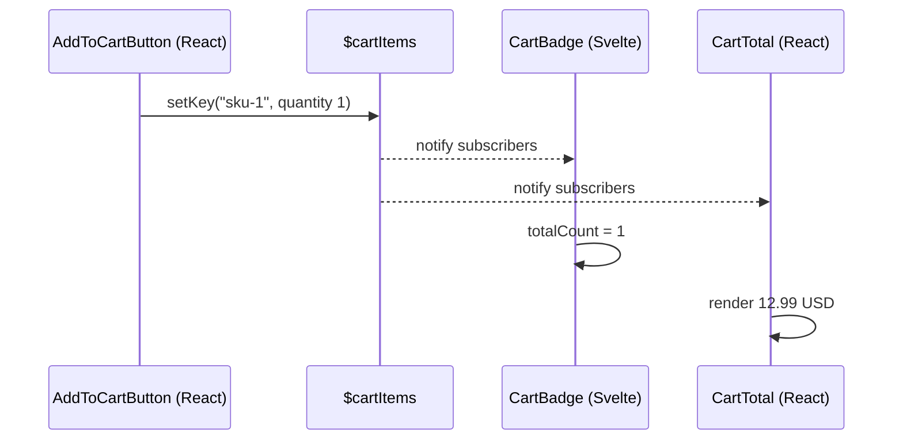

| Option | Works across frameworks | Survives full page navigation | Typical use |
| --- | --- | --- | --- |
| Nanostores | Yes | No (module state resets on each page load) | Cart count, UI toggles shared by islands |
| `@nanostores/persistent` | Yes | Yes, via `localStorage` | Cart contents, preferences |
| Framework context (React Context, Svelte context) | No, one tree only | No | State inside a single island |
| Custom DOM events (`dispatchEvent`) | Yes | No | Loose coupling between scripts and islands |
| URL search params | Yes | Yes, and shareable | Filters, tabs, pagination |
| Server state (cookie, session) | Yes | Yes | Anything the server must trust |

Store state only exists in the browser. During server rendering every island renders with the store's initial value, so a badge that should show a stored count renders `0` first and updates after hydration. Reserve its width to avoid layout shift.

### 3.10 Case Study: The Accidental Full-Bundle Hydration

- **Situation.** A documentation portal moved from a React SPA to Astro to improve mobile Core Web Vitals. After launch, lab scores barely moved.
- **Root cause.** The team had added `client:load` to every React component during the migration "to be safe". Every page downloaded and hydrated the whole component set on load, which recreated the SPA's main-thread cost inside an Astro page.
- **Diagnosis.** Searching the codebase for `client:load` returned dozens of hits. The browser's network panel showed the React runtime and every component chunk requested before first interaction, and the performance panel showed long hydration tasks.
- **Remediation.** Most components rendered static content and needed no directive. They became plain server-rendered components or were rewritten as `.astro`. The remaining widgets moved to `client:visible` or `client:idle`, and only the mobile navigation toggle kept `client:load`. Client JavaScript per page dropped by an order of magnitude.
- **Prevention.** A CI check counts `client:load` occurrences and fails when it grows without review, and the team uses `chooseDirective()`-style rules in code review.

### 3.11 Pitfalls

| Pitfall | Symptom | Fix |
| --- | --- | --- |
| Directive on an Astro component | Nothing happens; `.astro` components never hydrate | Use a `<script>` inside it, or convert it to a framework component |
| `client:only` without a framework name | `When using the client:only hydration strategy, Astro needs a hint to use the correct renderer.` | `client:only="react"` (or `"svelte"`, `"vue"`, ...) |
| Framework component with no integration installed | `Unable to render ComponentName` with the hint `Did you mean to enable the @astrojs/react integration?` | `npx astro add react` |
| Function passed as an island prop | Callback is `undefined` in the browser, silently | Move the logic into the island, or communicate through a store or DOM event |
| `client:only` island without reserved space | Content jumps when the island appears (CLS) | Give the wrapper a fixed `min-height` or aspect ratio |
| Hydration mismatch from `Date.now()` or `Math.random()` in a framework component | Framework warning about server and client markup differing; flicker | Compute such values in an effect after mount, or pass them as props |
| Expecting frontmatter variables inside a processed `<script>` | `ReferenceError` or `undefined` in the browser | Pass values through `data-*` attributes, or use `define:vars` with an inline script |
| Defining a custom element twice | `NotSupportedError: ... has already been used with this registry` | Guard with `customElements.get(name)` as the starter does |
| Importing a store named `$cartItems` directly in Svelte | Svelte compile error about the reserved `$` prefix | Alias the import: `import { $cartItems as cartItems }` |
| `client:load` everywhere | Lab scores and INP no better than the SPA you replaced | Default to no directive; justify each `client:load` |

### 3.12 Best Practices

- **Start with no directive and add one only when a component must react to input**: static is the cheapest and most reliable island.
- **Prefer the latest trigger that still feels instant** (`visible` > `idle` > `load`): later loading means less competition with content.
- **Use a processed script for small behaviours**: a custom element costs a few hundred bytes; a framework runtime costs tens of kilobytes.
- **Keep island logic in `src/lib/` and test it in Node**: `nextCount()` is tested without a DOM.
- **Pass ids and small objects as props, not whole datasets**: props are inlined into the HTML of every page that renders the island.
- **Load one framework per site where possible**: two renderers on one page means two runtimes to download.
- **Reserve layout space for anything that renders late**: `client:only` and store-driven values are the main sources of CLS in Astro sites.

### 3.13 Hands-on Exercise

Add a "copy to clipboard" island to the stage pages without a UI framework.

1. Create `src/components/CopyLink.astro` that renders `<copy-link data-path={Astro.url.pathname}><button type="button">Copy link</button><span role="status"></span></copy-link>`.
2. In a processed `<script>`, define `copy-link` with a `customElements.get()` guard. On click, call `navigator.clipboard.writeText(new URL(this.dataset.path ?? '/', location.origin).href)` and set the status text to `Copied`.
3. Render it in `src/pages/stages/[slug].astro` below `<StageNav />`.
4. Add a Container API test asserting that the rendered HTML contains `<copy-link` and a `data-path` attribute.

**Expected output:** each stage page in `dist/stages/*/index.html` contains one `<copy-link>` element and one module script that defines it, the home page contains no `copy-link` code, and `npm test` gains one passing test. Use `src/components/Counter.astro` and its test in `test/components.test.ts` as the template.

[Back to top ⤴️](#-table-of-contents)

---

## 4. Stage 4: Routing, Content Collections & Data Fetching

This stage turns Markdown, MDX, JSON and remote data into typed, validated collections and routes. It assumes Stage 2's routing basics. Afterwards a bad frontmatter field fails the build instead of shipping a broken page.

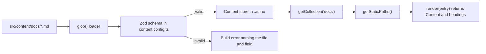

### 4.1 The Content Collections API

Astro treats Markdown, MDX, JSON and YAML as typed data sources. Since 6.0 every collection is defined in `src/content.config.ts` with a loader that says where the entries come from, and a Zod schema that each entry must match at build time.

```ts
// src/content.config.ts
import { defineCollection } from 'astro:content';
import { glob } from 'astro/loaders';
import { z } from 'astro/zod';

const docs = defineCollection({
  loader: glob({ pattern: '**/*.{md,mdx}', base: './src/content/docs' }),
  schema: z.object({
    title: z.string().min(5).max(120),
    description: z.string().max(250),
    category: z.enum(['architecture', 'devops', 'security', 'database']),
    publishedDate: z.coerce.date(),
    updatedDate: z.coerce.date().optional(),
    author: z.object({
      name: z.string(),
      avatarUrl: z.url(),
    }),
    tags: z.array(z.string()).min(1),
    isDraft: z.boolean().default(false),
  }),
});

export const collections = { docs };
```

The legacy form (`src/content/config.ts`, `type: 'content'`, `z` from `astro:content`) was removed in 6.0. `z.coerce.date()` accepts the YAML date strings that frontmatter produces, and `z.url()` is Zod 4's replacement for `z.string().url()`.

### 4.2 Querying and Rendering Content Collections

```astro
---
// src/pages/docs/[...id].astro
import { getCollection, render } from 'astro:content';
import DocLayout from '../../layouts/DocLayout.astro';

// Static site path generation at build time
export async function getStaticPaths() {
  const entries = await getCollection('docs', ({ data }) => (import.meta.env.PROD ? !data.isDraft : true));
  return entries.map((entry) => ({
    params: { id: entry.id },
    props: { entry },
  }));
}

const { entry } = Astro.props;
// render() compiles the Markdown body and returns its component and heading list.
const { Content, headings } = await render(entry);
---

<DocLayout title={entry.data.title} headings={headings}>
  <h1>{entry.data.title}</h1>
  <p class="meta">Published: {entry.data.publishedDate.toLocaleDateString('en-GB')}</p>
  <article class="prose">
    <Content />
  </article>
</DocLayout>
```

`entry.id` replaced `entry.slug` with the Content Layer; for `glob()` it is the file path relative to `base` without the extension, so a rest parameter (`[...id]`) handles nested folders.

### 4.3 MDX: Components Inside Markdown

MDX lets prose embed components. Install it with `npx astro add mdx`, then add the extension to the collection's `glob()` pattern.

```mdx
---
title: "Distributed Consensus Algorithms"
description: "Leader election and log replication in Raft"
category: "architecture"
publishedDate: 2026-03-15
author:
  name: "Staff Systems Engineer"
  avatarUrl: "https://example.com/avatars/engineer.png"
tags: ["distributed-systems", "raft", "consensus"]
---

import RaftSimulator from '../../components/react/RaftSimulator';
import CalloutAlert from '../../components/CalloutAlert.astro';

## Distributed Consensus Architecture

Leader election in Raft relies on randomised election timeouts to prevent split votes:

<CalloutAlert type="warning">
  In network partitions, minority quorums must never commit log entries to state machines.
</CalloutAlert>

Interact with the simulation below to see heartbeats drop:

<RaftSimulator client:visible nodeCount={5} heartbeatMs={150} />
```

Directives work inside MDX exactly as in `.astro` files, so the simulator above ships JavaScript only when scrolled into view.

### 4.4 Internationalisation (i18n) Routing

Astro has built-in locale routing (since 4.0):

```js
// astro.config.mjs
import { defineConfig } from 'astro/config';

export default defineConfig({
  i18n: {
    defaultLocale: 'en',
    locales: ['en', 'es', 'de', 'ja'],
    routing: {
      prefixDefaultLocale: false, // /about for English, /es/about for Spanish
    },
  },
});
```

Pages for other locales live in `src/pages/es/`, `src/pages/de/` and so on. `getRelativeLocaleUrl('es', 'about')` from `astro:i18n` builds links, and `Astro.currentLocale` tells a component which locale it is rendering. Since 6.0, `routing.redirectToDefaultLocale` defaults to `false`.

[Back to top ⤴️](#-table-of-contents)

---

## 5. Stage 5: Endpoints, Middleware, Actions & Testing

This stage builds the server side of an Astro project: endpoints that run per request, middleware that wraps every request, and streaming responses. On-demand routes need an adapter (Stage 6). Afterwards one Astro project can serve both pages and a small API.

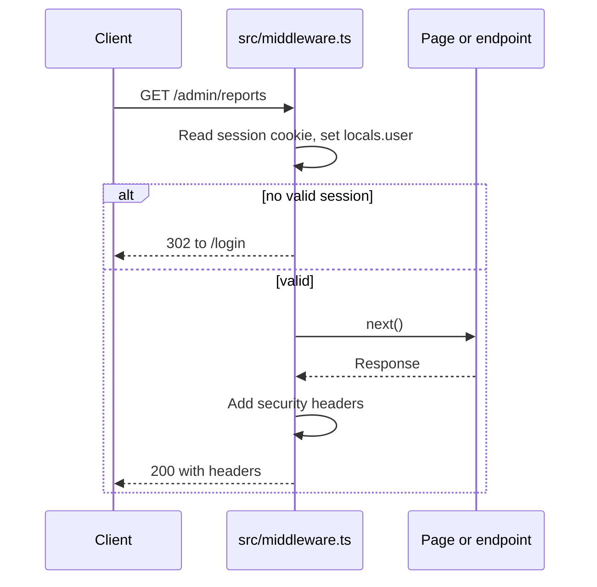

### 5.1 Defining Dynamic API Endpoints (`GET`, `POST`)

```ts
// src/pages/api/health.ts
import type { APIRoute } from 'astro';

// Run on every request instead of once at build time (needs an adapter).
export const prerender = false;

export const GET: APIRoute = () =>
  Response.json({
    status: 'HEALTHY',
    timestamp: new Date().toISOString(),
    uptimeSeconds: Math.round(process.uptime()), // Node adapter only
  });
```

`process.uptime()` exists in the Node adapter; on edge runtimes such as Cloudflare Workers use only Web APIs.

### 5.2 Middleware: Auth Guards and Security Headers

Middleware intercepts requests before pages or endpoints render, which is the place for session checks, redirects and response headers:

```ts
// src/middleware.ts
import { defineMiddleware } from 'astro:middleware';

export const onRequest = defineMiddleware(async (context, next) => {
  const { url, cookies, locals } = context;

  // Protect internal admin routes
  if (url.pathname.startsWith('/admin')) {
    const sessionToken = cookies.get('session_token')?.value;

    if (!sessionToken || !validateAuthToken(sessionToken)) {
      return context.redirect('/login?error=unauthorized');
    }

    // Attach the identity to locals for pages and endpoints downstream
    locals.user = { id: 'admin_usr_01', role: 'SUPERADMIN' };
  }

  const response = await next();

  response.headers.set('X-Frame-Options', 'DENY');
  response.headers.set('X-Content-Type-Options', 'nosniff');
  response.headers.set('Strict-Transport-Security', 'max-age=31536000; includeSubDomains');

  return response;
});

function validateAuthToken(token: string): boolean {
  return token.length > 20; // Placeholder: verify a signed session in real code
}
```

Declare the shape of `locals` in `src/env.d.ts` (`declare namespace App { interface Locals { user?: { id: string; role: string } } }`) so pages get types. For prerendered pages middleware runs at build time, so cookies and per-user logic only apply to on-demand routes.

### 5.3 Streaming Responses with Server-Sent Events

On-demand endpoints can return a `ReadableStream`, which is enough for server-sent events without a WebSocket server:

```ts
// src/pages/api/telemetry-stream.ts
import type { APIRoute } from 'astro';

export const prerender = false;

export const GET: APIRoute = ({ request }) => {
  const encoder = new TextEncoder();
  let timer: ReturnType<typeof setInterval> | undefined;

  const stream = new ReadableStream({
    start(controller) {
      let counter = 0;
      timer = setInterval(() => {
        counter++;
        const payload = { timestamp: new Date().toISOString(), cpuLoad: (Math.random() * 40 + 20).toFixed(1), counter };
        controller.enqueue(encoder.encode(`data: ${JSON.stringify(payload)}\n\n`));
        if (counter >= 100) {
          clearInterval(timer);
          controller.close();
        }
      }, 1000);
      // Stop work when the browser disconnects.
      request.signal.addEventListener('abort', () => clearInterval(timer));
    },
    cancel() {
      clearInterval(timer);
    },
  });

  return new Response(stream, {
    headers: {
      'Content-Type': 'text/event-stream',
      'Cache-Control': 'no-cache',
      Connection: 'keep-alive',
    },
  });
};
```

The browser side is `new EventSource('/api/telemetry-stream')`. Proxies that buffer responses (some nginx defaults) break streaming; set `proxy_buffering off` for this path.

[Back to top ⤴️](#-table-of-contents)

---

## 6. Stage 6: On-Demand Rendering, Performance & Deployment

This stage chooses where each route renders, configures adapters, optimises images and Core Web Vitals, and ships the result as static files or a container. Afterwards you can deploy the starter to any static host and an SSR variant to Node, Cloudflare or a container platform.

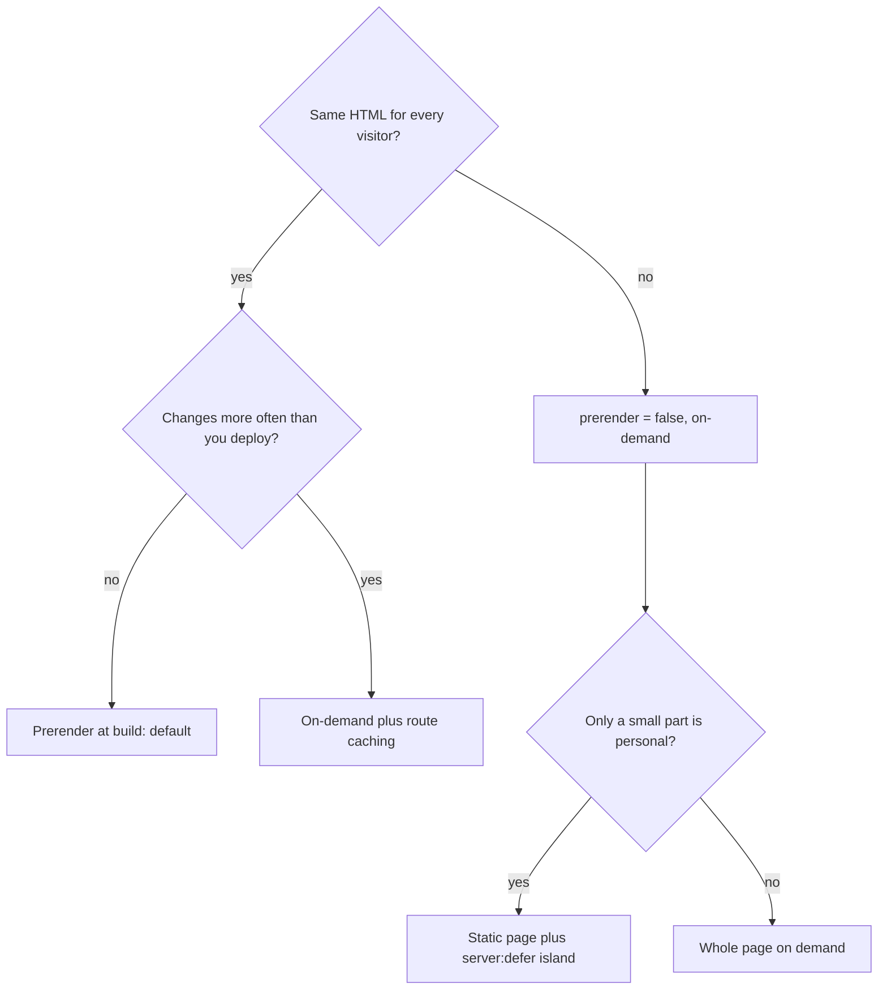

### 6.1 Rendering Modes Overview

Since 5.0 there are two output settings, and any route can opt out of the default:

1. **`output: 'static'` (default).** Every route is prerendered at build time. A route that exports `export const prerender = false` renders per request instead, which requires an adapter. This replaced the old `output: 'hybrid'`, which was removed in 5.0.
2. **`output: 'server'`.** Every route renders per request unless it exports `export const prerender = true`. Use it for authenticated consoles or personalised dashboards where most pages are dynamic.

Server islands (M1) add a third option inside a single page: a static, cacheable shell with dynamic fragments.

### 6.2 Adapter Configuration: Node.js

```js
// astro.config.mjs (on-demand Node.js server)
import { defineConfig } from 'astro/config';
import node from '@astrojs/node';

export default defineConfig({
  output: 'server',
  adapter: node({
    mode: 'standalone', // builds dist/server/entry.mjs, an HTTP server you run with node
  }),
});
```

`mode: 'middleware'` instead exports a handler for Express or Fastify. Without an adapter, a route with `prerender = false` fails the build with `Cannot use server-rendered pages without an adapter.`

### 6.3 Edge Deployments on Cloudflare Workers

```js
// astro.config.mjs (Cloudflare adapter)
import { defineConfig } from 'astro/config';
import cloudflare from '@astrojs/cloudflare';

export default defineConfig({
  output: 'server',
  adapter: cloudflare(),
});
```

```ts
// src/pages/api/users.ts: query a D1 database binding
import type { APIRoute } from 'astro';
import { env } from 'cloudflare:workers';

export const GET: APIRoute = async () => {
  const { results } = await env.DB.prepare('SELECT id, name, role FROM users LIMIT 50').all();
  return Response.json(results);
};
```

Current adapter versions removed `Astro.locals.runtime`: bindings come from `env` in `cloudflare:workers`, `cf` request data from `Astro.request.cf`, and the execution context from `Astro.locals.cfContext`. Bindings such as `DB` are declared in `wrangler.jsonc`.

### 6.4 The Image Component Pipeline

`astro:assets` optimises local and authorised remote images with Sharp at build time (or on demand with an adapter): it resizes, converts to WebP or AVIF, and writes `width` and `height` so the browser reserves space.

```astro
---
// src/pages/about.astro
import { Image } from 'astro:assets';
import architectureImage from '../assets/architecture-diagram.png';
---

<Image
  src={architectureImage}
  alt="Distributed cloud architecture overview"
  width={1200}
  format="avif"
  quality={80}
  loading="eager"
  class="hero"
/>
```

Height is inferred from the imported file's aspect ratio. Use `loading="eager"` only for the LCP image; everything else keeps the default lazy loading. `<Picture />` emits several formats with fallbacks.

### 6.5 Core Web Vitals Blueprint

| Metric (good threshold) | Main Astro levers |
| --- | --- |
| LCP (2.5 s or less) | Prerender pages; eager-load and preload only the hero image (`<link rel="preload" as="image" fetchpriority="high">`); keep critical CSS inlined (`build.inlineStylesheets: 'auto'`) |
| INP (200 ms or less) | No directive by default; `client:idle` or `client:visible` for secondary widgets; avoid one large framework island that wraps the page |
| CLS (0.1 or less) | `<Image />` writes dimensions; reserve space for `client:only` islands and server-island fallbacks; avoid late-loading web fonts without `font-display` and size-adjusted fallbacks |

### 6.6 Production Dockerfile for the Node Adapter

The starter's own `Dockerfile` serves static output with nginx. For an SSR build with `@astrojs/node` in standalone mode, ship the server entry and production dependencies only:

```dockerfile
# Multi-stage production image for Astro with @astrojs/node (standalone)
FROM node:24-alpine AS build
WORKDIR /app
COPY package.json package-lock.json ./
RUN npm ci
COPY . .
RUN npm run build

FROM node:24-alpine AS deps
WORKDIR /app
COPY package.json package-lock.json ./
RUN npm ci --omit=dev

FROM node:24-alpine AS runtime
WORKDIR /app
ENV NODE_ENV=production HOST=0.0.0.0 PORT=8080
COPY --from=deps /app/node_modules ./node_modules
COPY --from=build /app/dist ./dist
COPY package.json ./
USER node
EXPOSE 8080
CMD ["node", "./dist/server/entry.mjs"]
```

The standalone server reads `HOST` and `PORT`, so the container listens on `0.0.0.0:8080` and `EXPOSE` matches it.

### 6.7 Lighthouse CI as a Performance Gate

```yaml
# .github/workflows/lighthouse.yml
name: Core Web Vitals gate

on:
  pull_request:
    branches: [main]

jobs:
  lighthouse:
    runs-on: ubuntu-latest
    steps:
      - uses: actions/checkout@v5
      - uses: actions/setup-node@v5
        with:
          node-version: 24
          cache: npm
      - run: npm ci
      - run: npm run build
      - name: Run Lighthouse CI
        uses: treosh/lighthouse-ci-action@v12
        with:
          configPath: ./lighthouserc.json
          uploadArtifacts: true
```

`lighthouserc.json` serves `dist/` and asserts budgets:

```json
{
  "ci": {
    "collect": { "staticDistDir": "./dist" },
    "assert": {
      "assertions": {
        "categories:performance": ["error", { "minScore": 0.95 }],
        "categories:accessibility": ["error", { "minScore": 1.0 }],
        "categories:best-practices": ["error", { "minScore": 1.0 }],
        "categories:seo": ["error", { "minScore": 1.0 }],
        "first-contentful-paint": ["error", { "maxNumericValue": 1000 }],
        "cumulative-layout-shift": ["error", { "maxNumericValue": 0.01 }]
      }
    }
  }
}
```

Lab scores vary between runs; set the thresholds a little below your typical score and track field data (CrUX or your own RUM) for the real picture.

[Back to top ⤴️](#-table-of-contents)

---

## M1. Masterclass: Server Islands

### M1.1 How Server Islands Work

Personalising one small part of a page (an avatar, a cart count, a price for the visitor's region) used to force the whole page into per-request rendering, losing CDN caching. Server islands split the page instead:

1. The page shell is prerendered or cached as static HTML.
2. A component marked `server:defer` is replaced in that HTML by its `fallback` slot and a small inline script.
3. The script requests the island's HTML from an adapter-served route under `/_server-islands/<ComponentName>`, with the component's props encrypted in the request, and swaps the response in place of the fallback.

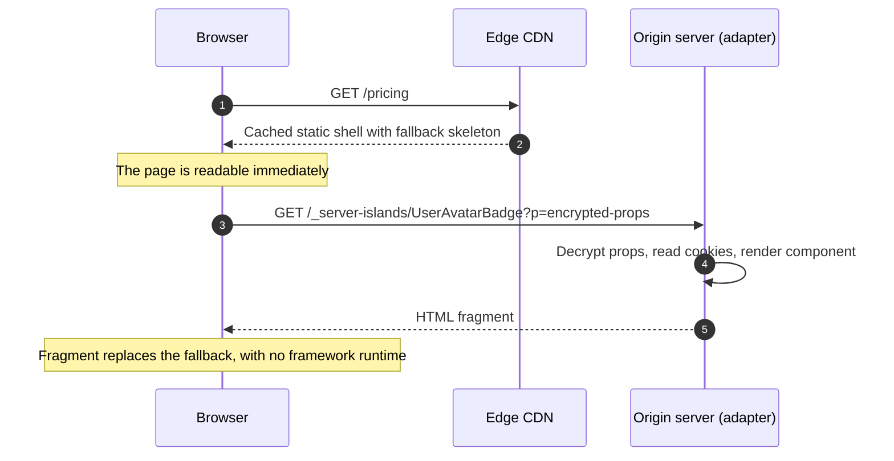

Props are encrypted with a key generated at build time. When several server instances or builds must accept each other's requests, generate one key with `astro create-key` and provide it to every build and server as `ASTRO_KEY`.

### M1.2 Worked Example: A Personalised Header on a Static Page

```astro
---
// src/components/UserAvatarBadge.astro
// Rendered on the server for each request to the island route.
import { getUserFromSession } from '../lib/session';

const sessionId = Astro.cookies.get('session')?.value;
const user = sessionId ? await getUserFromSession(sessionId) : undefined;
---

{user ? (
  <div class="user-badge">
    
    <span>{user.name}</span>
  </div>
) : (
  <a href="/login">Sign in</a>
)}
```

```astro
---
// src/pages/index.astro: prerendered; only the badge is dynamic
import UserAvatarBadge from '../components/UserAvatarBadge.astro';
---

<header class="navbar">
  <div class="logo">CloudScale</div>

  <UserAvatarBadge server:defer>
    <div slot="fallback" class="badge-skeleton" style="width: 6rem; height: 2rem"></div>
  </UserAvatarBadge>
</header>
```

The island reads cookies itself. It cannot rely on `Astro.locals` set by middleware for the prerendered page, because that page was rendered at build time; middleware does run again for the island's own request.

### M1.3 Server Islands Compared with Alternatives

| Approach | Shell cacheable | Client JS | Personal data | Cost |
| --- | --- | --- | --- | --- |
| Whole page on demand | Only with per-user cache keys | None required | Yes | Every request hits the server |
| Server island (`server:defer`) | Yes | Small inline loader | Yes, inside the island | One extra request per island |
| Client fetch in a framework island | Yes | Framework runtime plus fetch code | Yes, via an API | JSON API to maintain, hydration cost |
| Edge-side includes (ESI) | Yes | None | Yes | CDN-specific configuration |

[Back to top ⤴️](#-table-of-contents)

---

## M2. Masterclass: View Transitions & the ClientRouter

### M2.1 Client Navigation without an SPA Framework

Astro's `<ClientRouter />` intercepts same-origin link clicks, fetches the next page's HTML, and swaps the document using the browser's View Transitions API where available (with a fallback animation elsewhere). State can persist across navigations without a client-side framework router.

```astro
---
// src/layouts/BaseLayout.astro
import { ClientRouter } from 'astro:transitions';

interface Props {
  title: string;
}

const { title } = Astro.props;
---

<html lang="en">
  <head>
    <meta charset="utf-8" />
    <title>{title}</title>
    <!-- Enables animated client-side navigation for every page using this layout -->
    <ClientRouter />
  </head>
  <body>
    <!-- The audio element is moved, not re-created, so playback continues across pages -->
    <aside transition:persist="audio-player" class="player-bar">
      <audio controls src="/stream.mp3"></audio>
    </aside>

    <!-- The main content cross-fades between pages -->
    <main transition:animate="fade">
      <slot />
    </main>
  </body>
</html>
```

With the router active, processed module scripts run once per session, not once per page. Code that must run on every navigation listens for `astro:page-load`:

```ts
document.addEventListener('astro:page-load', () => {
  document.querySelector('[data-autofocus]')?.focus();
});
```

The 6.x constants (`TRANSITION_AFTER_SWAP` and friends) and `isTransitionBeforeSwapEvent()` were removed in 7.0; compare `event.type` with the event name strings instead.

[Back to top ⤴️](#-table-of-contents)

---

## M3. Masterclass: Multi-Framework Islands & Monorepos

### M3.1 Configuring Several Frameworks in One Project

Teams can combine a React design system, a Vue widget library and Svelte micro-interactions in one project. React, Preact and Solid all compile JSX, so when more than one JSX framework is installed each needs an `include` pattern to say which files it owns:

```js
// astro.config.mjs
import { defineConfig } from 'astro/config';
import react from '@astrojs/react';
import preact from '@astrojs/preact';
import vue from '@astrojs/vue';
import svelte from '@astrojs/svelte';
import tailwindcss from '@tailwindcss/vite';

export default defineConfig({
  integrations: [
    react({ include: ['**/react/*'] }),
    preact({ include: ['**/preact/*'] }),
    vue(),
    svelte(),
  ],
  vite: {
    // Tailwind CSS 4 runs as a Vite plugin; the old @astrojs/tailwind integration is deprecated.
    plugins: [tailwindcss()],
  },
});
```

### M3.2 Monorepo Structure for Several Astro Apps

Organisations with several Astro sites share design tokens, auth helpers and islands through workspace packages:

```text
apps/
  marketing-portal/      # Astro, static output
  documentation-hub/     # Astro, content collections and Pagefind
  customer-dashboard/    # Astro, on-demand rendering with the Node adapter
packages/
  ui-components/         # shared Astro components and framework islands
  auth-client/           # shared session verification used by middleware
  typescript-config/     # shared tsconfig.base.json extending astro/tsconfigs/strict
```

Shared `.astro` components can be published as source in a workspace package; Astro compiles them when an app imports them.

[Back to top ⤴️](#-table-of-contents)

---

## M4. Masterclass: Zero-Runtime Search with Pagefind

### M4.1 Static Search Indexed after the Build

Pagefind indexes the built HTML and writes a chunked index plus a small UI to `dist/pagefind/`. A query downloads only the index fragments it needs, so search works on a static host with no search server.

```bash
# Build the site, then index dist/ (writes dist/pagefind/)
npm run build && npx -y pagefind --site dist
```

```astro
---
// src/components/SearchModal.astro
---

<link href="/pagefind/pagefind-ui.css" rel="stylesheet" />
<div id="search"></div>

<!-- is:inline: these files only exist after the post-build indexing step -->
<script is:inline src="/pagefind/pagefind-ui.js"></script>
<script is:inline>
  window.addEventListener('DOMContentLoaded', () => {
    new PagefindUI({ element: '#search', showImages: false, resetStyles: false });
  });
</script>

<style is:global>
  .pagefind-ui {
    --pagefind-ui-primary: #38bdf8;
    --pagefind-ui-text: #f3f4f6;
    --pagefind-ui-background: #111827;
    --pagefind-ui-border: #374151;
  }
</style>
```

Search does not work under `astro dev`, because `dist/pagefind/` is produced only after a build. Test it with `astro preview` after indexing.

[Back to top ⤴️](#-table-of-contents)

---

## M5. Masterclass: Flagship Blueprint: Production Storefront

### M5.1 Checkout Endpoint with Server-Side Prices

The checkout endpoint must never trust prices from the browser. It receives product ids and quantities, looks prices up on the server, and creates a hosted checkout session:

```ts
// astro.config.mjs (excerpt): declare the secret so it is read at runtime, not inlined
import { defineConfig, envField } from 'astro/config';

export default defineConfig({
  env: {
    schema: {
      STRIPE_SECRET_KEY: envField.string({ context: 'server', access: 'secret' }),
    },
  },
});
```

```ts
// src/pages/api/checkout.ts
import type { APIRoute } from 'astro';
import Stripe from 'stripe';
import { STRIPE_SECRET_KEY } from 'astro:env/server';
import { findProduct } from '../../lib/catalog';

export const prerender = false;

const stripe = new Stripe(STRIPE_SECRET_KEY);

export const POST: APIRoute = async ({ request, url }) => {
  const { items } = (await request.json()) as { items: Array<{ id: string; quantity: number }> };

  const lineItems = items.map(({ id, quantity }) => {
    const product = findProduct(id); // server-side catalogue lookup
    if (!product || !Number.isInteger(quantity) || quantity < 1) throw new Error(`Invalid item ${id}`);
    return {
      price_data: { currency: 'usd', product_data: { name: product.name }, unit_amount: product.priceCents },
      quantity,
    };
  });

  try {
    const session = await stripe.checkout.sessions.create({
      mode: 'payment',
      line_items: lineItems,
      success_url: `${url.origin}/checkout/success?session_id={CHECKOUT_SESSION_ID}`,
      cancel_url: `${url.origin}/checkout/cancel`,
    });
    return Response.json({ url: session.url });
  } catch (error) {
    return Response.json({ error: (error as Error).message }, { status: 500 });
  }
};
```

`import.meta.env` values are inlined at build time since 6.0, so secrets read that way end up in the server bundle. `astro:env` with `access: 'secret'` reads them from the environment when the server runs.

### M5.2 Production Checklist

- [ ] Content collections validated with strict Zod schemas, and `astro check` passes in CI.
- [ ] `client:load` reserved for controls that must work in the first second; everything else uses `idle`, `visible` or no directive.
- [ ] All images use `<Image />` or `<Picture />` with dimensions, so CLS stays near zero.
- [ ] On-demand routes are explicit (`prerender = false`) and an adapter is configured.
- [ ] Middleware sets security headers (`X-Frame-Options`, HSTS, a CSP via `security.csp` where possible).
- [ ] View transitions tested with `<ClientRouter />`, including scripts that must re-run on `astro:page-load`.
- [ ] Secrets come from `astro:env/server`, never from `import.meta.env` in server code that is built once.
- [ ] Lighthouse CI gates pull requests, and field data is monitored after release.

[Back to top ⤴️](#-table-of-contents)

---

## 7. Stage 7: Staff Astro Web Architect Interview Handbook & Cheatsheet

### 7.1 Core Concepts (Q1-Q2)

#### Q1. Under what conditions would you choose Next.js over Astro, and vice versa?

Choose Astro for content-rich sites: documentation, marketing, publishing, and storefront catalogues where most of each page is read rather than manipulated, and where search ranking and mobile Core Web Vitals matter. Astro's default of zero client JavaScript, its content collections and its per-island hydration fit sites where 80 percent or more of the page is presentation with a few interactive widgets.

Choose Next.js (or another app framework) for authenticated, state-heavy applications such as editors, design tools and issue trackers, where nearly every interaction changes client state, the UI is one large interactive tree, and real-time updates dominate. There the React runtime is needed on every page anyway, and Astro's island boundaries add friction instead of saving bytes.

#### Q2. How do Astro server islands differ from React Server Components (RSC)?

React Server Components render on the server and send a serialised component payload (the RSC wire format) to the browser. The client needs the React runtime to reconcile that payload into the DOM and to hydrate the client components it references, so React is always present on the page. Server components themselves ship no component code, but the page is still a React application.

Astro server islands return plain HTML from a separate request and swap it into the static page with a small inline script. No framework runtime is needed unless the island itself contains a framework component with a client directive. The trade-off is granularity and latency: an island is a separate HTTP request, while RSC streams within the page's response and can interleave server and client components at any depth.

### 7.2 Staff Cheatsheet

| Concept / directive | Syntax | Runs where |
| :--- | :--- | :--- |
| Component frontmatter | `--- code ---` | Server only (build time or per request) |
| Server island | `<Component server:defer />` | Server, in a separate request from the page |
| Client idle | `<Component client:idle />` | Browser, when the main thread is idle |
| Client visible | `<Component client:visible />` | Browser, when scrolled into the viewport |
| View transitions | `<ClientRouter />` | Browser, client-side navigation |
| Content collection | `getCollection('docs')` | Build time, or per request for live collections |
| Nanostores | `useStore($store)` | Browser, shared across islands on one page |
| On-demand route | `export const prerender = false` | Server, per request (adapter required) |
| Route caching | `Astro.cache.set({ maxAge, swr, tags })` | Server, with a configured cache provider |

[Back to top ⤴️](#-table-of-contents)

---

## 🧪 Example Projects

| Project | Builds on | What you practise | Stretch goal |
| --- | --- | --- | --- |
| [Starter project](./src) (in this repo) | [Stage 1](#1-stage-1-setup-project-anatomy--the-rendering-model), [Stage 2](#2-stage-2-astro-components-templates-props--slots), [Stage 3](#3-stage-3-islands-client-directives--client-side-state) | Layouts, props and slots, `getStaticPaths()`, a static JSON endpoint, a custom-element island, Container API tests, nginx Docker image | Add the `/topics/[topic]/` routes from exercise 2.12 |
| Personal blog | [4.1](#41-the-content-collections-api), [4.2](#42-querying-and-rendering-content-collections), [6.4](#64-the-image-component-pipeline) | Content collections, Markdown, RSS endpoint, optimised images | Tag pages and pagination with `paginate()` |
| Documentation site | [4.3](#43-mdx-components-inside-markdown), [M4](#m4-masterclass-zero-runtime-search-with-pagefind) | MDX with interactive examples, Pagefind search, sidebar layouts | Versioned docs with i18n routing |
| Product landing page | [3.2](#32-client-directives), [6.5](#65-core-web-vitals-blueprint) | Directive selection, LCP image, Lighthouse CI budget | Score 100 in all Lighthouse categories on mobile |
| Storefront | [3.9](#39-sharing-state-between-islands-with-nanostores), [M5](#m5-masterclass-flagship-blueprint-production-storefront) | Cross-framework cart state, server-side checkout, `astro:env` secrets | Persist the cart with `@nanostores/persistent` |
| Personalised news portal | [M1](#m1-masterclass-server-islands), [6.1](#61-rendering-modes-overview) | Static shell with server islands, cookies, route caching | Cache invalidation by tag when an article changes |
| Status dashboard | [5.3](#53-streaming-responses-with-server-sent-events), [6.2](#62-adapter-configuration-nodejs) | SSE endpoint, Node adapter, Docker | Deploy the same app to Cloudflare Workers |
| Multi-site monorepo | [M3](#m3-masterclass-multi-framework-islands--monorepos) | Shared component packages, one design system across apps | Visual regression tests for shared components |

## 📝 Cheat Sheets

### CLI / Commands

```bash
npm create astro@latest my-site -- --template minimal   # scaffold
npm run dev                         # astro dev on :4321
npx astro dev --host --port 3000    # bind all interfaces, other port
npx astro dev stop                  # stop a background dev server (7.x)
npm run build                       # astro build into dist/
npx astro build --timings           # build-time breakdown (7.4)
npm run preview                     # serve the production build
npx astro check                     # type-check .astro and .ts files
npx astro sync                      # regenerate .astro/types.d.ts
npx astro add react                 # add an integration
npx astro add node                  # add an adapter
npx astro info                      # versions for bug reports
npx astro create-key                # key for server island props (ASTRO_KEY)
npx @astrojs/upgrade                # upgrade astro and @astrojs/* together
npx vitest run                      # run the starter's tests
docker build -t learn-astro . && docker run -p 8080:8080 learn-astro
```

### Syntax / API Quick Reference

| Task | Code |
| --- | --- |
| Typed props | `interface Props { title: string }` then `const { title } = Astro.props;` |
| Default prop | `const { badge = 'Core' } = Astro.props;` |
| Default slot | `<slot />` |
| Named slot | `<slot name="footer" />` and `<p slot="footer">` |
| Slot check | `Astro.slots.has('footer')` |
| Conditional class | `<p class:list={['note', { active }]}>` |
| Raw HTML | `<Fragment set:html={trustedHtml} />` |
| Dynamic route | `export const getStaticPaths = () => [{ params: { slug: 'a' } }];` |
| Static endpoint | `export const GET: APIRoute = () => Response.json(data);` |
| On-demand route | `export const prerender = false;` |
| Island | `<Widget client:visible />` |
| Browser-only island | `<Map client:only="react" />` |
| Inline script | `<script is:inline>...</script>` |
| Styles from frontmatter | `<style define:vars={{ accent }}>` |
| Collection query | `const posts = await getCollection('blog');` |
| Render an entry | `const { Content } = await render(entry);` |
| Server island | `<Badge server:defer><Skeleton slot="fallback" /></Badge>` |
| Render a component in a test | `await container.renderToString(Card, { props, slots })` |

## 📚 Resources

- [Astro documentation](https://docs.astro.build/)
- [Astro API reference](https://docs.astro.build/en/reference/api-reference/)
- [Astro configuration reference](https://docs.astro.build/en/reference/configuration-reference/)
- [Astro upgrade guides](https://docs.astro.build/en/upgrade-astro/)
- [Astro blog (release announcements)](https://astro.build/blog/)
- [Astro changelog](https://github.com/withastro/astro/blob/main/packages/astro/CHANGELOG.md)
- [Astro source repository](https://github.com/withastro/astro)
- [Vite documentation](https://vite.dev/)
- [Vitest documentation](https://vitest.dev/)

## 🤝 Contributing

Contributions are welcome. Read the [contributing guide](https://github.com/TheLearningHubOrg/.github/blob/main/CONTRIBUTING.md) and the [code of conduct](https://github.com/TheLearningHubOrg/.github/blob/main/CODE_OF_CONDUCT.md) before you open a pull request. Commit messages follow [Conventional Commits](https://www.conventionalcommits.org/), which drive the automated changelog.

## 📄 License

This project is licensed under the MIT License. See the [LICENSE](LICENSE) file for details.

## 🙏 Acknowledgments

- [Astro](https://astro.build) and its maintainers
- [Vite](https://vite.dev/) and [Vitest](https://vitest.dev/), which build and test the starter project
- [nginx](https://nginx.org/), which serves the starter's Docker image

## 🌐 Connect with me

- [Twitter](https://twitter.com/manthan_ank)
- [LinkedIn](https://www.linkedin.com/in/manthanank)
- [Facebook](https://www.facebook.com/manthanank/)
- [Instagram](https://www.instagram.com/manthan_ank/)
- [YouTube](https://www.youtube.com/@manthanank)
- [GitHub](https://github.com/manthanank)

## ☕ Support

If you like this learning repository and find it useful, consider buying me a coffee or sponsoring me through GitHub Sponsors. Your support helps me keep these guides up to date. Thank you!

[](https://www.buymeacoffee.com/manthanank)

[](https://github.com/sponsors/manthanank)

---

Show your support by 🌟 the repository.
