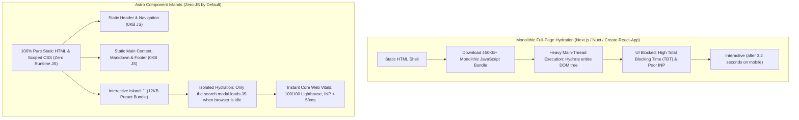
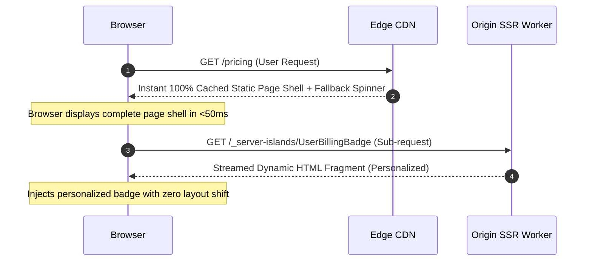

# Learn Astro: From Zero to Staff Web Infrastructure Architect

[]()
[]()
[]()
[](LICENSE)

> **The definitive production masterclass on Astro 5 web infrastructure, Islands Architecture, Server Islands, type-safe Content Collections with Zod, multi-framework orchestration (React, Vue, Svelte), hybrid rendering, Nanostores cross-island state, and sub-second Core Web Vitals engineering.**

---

## Table of Contents
1. [Architectural Comparison: Monolithic SPA Hydration vs. Astro Islands](#architectural-comparison-monolithic-spa-hydration-vs-astro-islands)
2. [Stage 1: Core Philosophy & The Zero-JS Baseline](#1-stage-1-core-philosophy--the-zero-js-baseline)
3. [Stage 2: Astro Component Architecture & The Frontmatter Engine](#2-stage-2-astro-component-architecture--the-frontmatter-engine)
4. [Stage 3: Islands Architecture & Client Directives](#3-stage-3-islands-architecture--client-directives)
5. [Stage 4: Multi-Framework Orchestration: React, Vue, Svelte & Solid](#4-stage-4-multi-framework-orchestration-react-vue-svelte--solid)
6. [Stage 5: Type-Safe Content Collections with Zod](#5-stage-5-type-safe-content-collections-with-zod)
7. [Stage 6: Routing Models: SSG, Hybrid & On-Demand SSR Adapters](#6-stage-6-routing-models-ssg-hybrid--on-demand-ssr-adapters)
8. [Stage 7: Server Islands: Dynamic Content on Static Pages](#7-stage-7-server-islands-dynamic-content-on-static-pages)
9. [Stage 8: View Transitions & SPA-Like Morph Navigation](#8-stage-8-view-transitions--spa-like-morph-navigation)
10. [Stage 9: Cross-Framework State Management with Nanostores](#9-stage-9-cross-framework-state-management-with-nanostores)
11. [Stage 10: Asset Optimization, Sharp Image Pipelines & Modern Styling](#10-stage-10-asset-optimization-sharp-image-pipelines--modern-styling)
12. [Stage 11: Middleware, Session Security & Authentication](#11-stage-11-middleware-session-security--authentication)
13. [Stage 12: Internationalization (i18n) & Localized Routing](#12-stage-12-internationalization-i18n--localized-routing)
14. [Stage 13: Core Web Vitals Optimization & 100/100 Lighthouse Engineering](#13-stage-13-core-web-vitals-optimization--100100-lighthouse-engineering)
15. [Stage 14: Enterprise Case Studies & Architecture Failure Post-Mortems](#14-stage-14-enterprise-case-studies--architecture-failure-post-mortems)
16. [Stage 15: Hands-On Production Implementation Lab](#15-stage-15-hands-on-production-implementation-lab)
17. [Stage 16: Staff Web Infrastructure Architect Interview Handbook](#16-stage-16-staff-web-infrastructure-architect-interview-handbook)
18. [Stage 17: Production Checklist & Deployment Runbook](#17-stage-17-production-checklist--deployment-runbook)
19. [Stage 18: Summary & Ecosystem Roadmap](#18-stage-18-summary--ecosystem-roadmap)

---

## Architectural Comparison: Monolithic SPA Hydration vs. Astro Islands



---

## 1. Stage 1: Core Philosophy & The Zero-JS Baseline

### 1.1 The Web Performance Crisis
Over the last decade, Single Page Application (SPA) architectures pushed frontend complexity to extremes. Web applications regularly ship megabytes of JavaScript just to render static marketing pages, blogs, and documentation hubs.

This causes severe performance degradation:
- **Interaction to Next Paint (INP)**: Heavy hydration blocks main thread responsiveness.
- **First Contentful Paint (FCP)**: Delayed by massive script evaluation.
- **Battery & CPU Drain**: Low-end mobile devices struggle to parse large JS bundles.

### 1.2 Astro's Core Paradigm: HTML-First & Opt-In Hydration
Astro fundamentally reverses this model:
1. **Server-Rendered HTML**: Every `.astro` component compiles ahead-of-time (or on-demand in SSR) into raw HTML and scoped CSS. **Zero JavaScript is sent to the client browser by default.**
2. **Component Islands**: Dynamic client-side interactivity is confined to isolated "islands" embedded inside the static HTML document.
3. **Bring Your Own Framework (BYOF)**: Rather than inventing a proprietary reactivity model, Astro allows developers to drop existing React, Vue, Svelte, Solid, and Preact components directly into pages.

---

## 2. Stage 2: Astro Component Architecture & The Frontmatter Engine

### 2.1 The Anatomy of an `.astro` File
Astro components resemble Markdown frontmatter combined with JSX-like templating:
- **Component Script (`---`)**: Executes exclusively on the server at build time or during SSR request handling. Node.js/web APIs, database calls, and fetch operations run here.
- **Component Template**: Renders raw HTML with JSX expressions.

```astro
---
// src/components/SystemMetricCard.astro
// --- The Frontmatter Script (Server-Side Only) ---
interface Props {
  title: string;
  metricValue: number;
  unit: string;
  status: 'healthy' | 'degraded' | 'critical';
}

const { title, metricValue, unit, status } = Astro.props;

// Pure server logic: Fetching, computing, database queries
const statusColorMap = {
  healthy: 'text-emerald-400 bg-emerald-950/40 border-emerald-500/30',
  degraded: 'text-amber-400 bg-amber-950/40 border-amber-500/30',
  critical: 'text-rose-400 bg-rose-950/40 border-rose-500/30'
};
---

<!-- The Component Template (HTML + Scoped Styles) -->
<div class="metric-card">
  <div class="flex items-center justify-between">
    <h3 class="metric-title">{title}</h3>
    <span class={`badge ${statusColorMap[status]}`}>{status.toUpperCase()}</span>
  </div>
  <p class="metric-display">
    <span class="value">{metricValue}</span>
    <span class="unit">{unit}</span>
  </p>
  <slot name="footer" />
</div>

<style>
  /* Scoped automatically to this component only */
  .metric-card {
    padding: 1.5rem;
    border-radius: 0.75rem;
    background: #111827;
    border: 1px solid #1f2937;
    transition: border-color 0.2s ease;
  }
  .metric-card:hover {
    border-color: #374151;
  }
  .metric-title {
    font-size: 0.875rem;
    color: #9ca3af;
    margin: 0;
  }
  .metric-display {
    margin-top: 1rem;
    display: flex;
    align-items: baseline;
    gap: 0.25rem;
  }
  .value {
    font-size: 2rem;
    font-weight: 700;
    color: #f9fafb;
  }
  .unit {
    color: #6b7280;
    font-size: 0.875rem;
  }
</style>
```

---

## 3. Stage 3: Islands Architecture & Client Directives

### 3.1 Granular Hydration Directives
When embedding interactive UI framework components (React, Vue, Svelte), Astro uses **Client Directives** to dictate exactly *when* and *how* the component's JavaScript should be loaded:

| Directive | Loading Trigger | Optimal Production Use Case | Performance Impact |
| :--- | :--- | :--- | :---: |
| *(None)* | Server render only | Pure presentation components, static cards | **0KB JS** sent |
| `client:load` | Immediately on page load | Critical interactive elements (primary nav, mobile drawer) | High priority JS bundle |
| `client:idle` | Once browser main thread is idle (`requestIdleCallback`) | Secondary interactivity (search bars, chat widgets) | Prevents blocking FCP/LCP |
| `client:visible` | When element enters viewport (`IntersectionObserver`) | Below-the-fold widgets (pricing calculator, comment thread) | Defers JS download entirely |
| `client:media` | When CSS media query matches (`window.matchMedia`) | Desktop-only sidebars or mobile-only bottom sheets | Eliminates unused device code |
| `client:only` | Skips server rendering, hydrates only on client | Components relying heavily on `window`/`localStorage` | Bypasses SSR mismatch bugs |

### 3.2 Real-World Island Composition in Astro
```astro
---
// src/pages/dashboard.astro
import BaseLayout from '../layouts/BaseLayout.astro';
import StaticOverview from '../components/StaticOverview.astro'; // Pure .astro (0KB JS)
import LiveTelemetryChart from '../components/react/LiveTelemetryChart'; // React Component
import SearchPalette from '../components/vue/SearchPalette.vue'; // Vue Component
import FeedbackWidget from '../components/svelte/FeedbackWidget.svelte'; // Svelte Component
---

<BaseLayout title="Infrastructure Monitoring">
  <!-- 1. Pure static HTML rendered on server -->
  <StaticOverview />

  <!-- 2. High priority interactive chart hydrated immediately -->
  <LiveTelemetryChart client:load initialMetrics={[]} />

  <!-- 3. Search modal: Defers JS until browser is completely idle -->
  <SearchPalette client:idle />

  <!-- 4. Feedback widget: Loads JS ONLY when user scrolls down to it -->
  <FeedbackWidget client:visible />
</BaseLayout>
```

---

## 4. Stage 4: Multi-Framework Orchestration: React, Vue, Svelte & Solid

### 4.1 Configuring the Multi-Framework Astro Ecosystem
Astro enables unprecedented architecture flexibility: development teams can combine React design systems, Vue component libraries, and ultra-fast Svelte interactive widgets within the exact same project:

```javascript
// astro.config.mjs
import { defineConfig } from 'astro/config';
import react from '@astrojs/react';
import vue from '@astrojs/vue';
import svelte from '@astrojs/svelte';
import tailwind from '@astrojs/tailwind';

export default defineConfig({
  integrations: [
    react({ include: ['**/react/*'] }),
    vue({ include: ['**/vue/*'] }),
    svelte({ include: ['**/svelte/*'] }),
    tailwind()
  ]
});
```

---

## 5. Stage 5: Type-Safe Content Collections with Zod

### 5.1 The Content Collections API
Astro treats Markdown and MDX documents as first-class, type-safe database tables using the **Content Collections API**. Every collection is verified at build time using a strict Zod schema:

```typescript
// src/content/config.ts
import { defineCollection, z } from 'astro:content';

const technicalDocsCollection = defineCollection({
  type: 'content', // Markdown / MDX files with frontmatter
  schema: z.object({
    title: z.string().min(5).max(120),
    description: z.string().max(250),
    category: z.enum(['architecture', 'devops', 'security', 'database']),
    publishedDate: z.date(),
    updatedDate: z.date().optional(),
    author: z.object({
      name: z.string(),
      avatarUrl: z.string().url()
    }),
    tags: z.array(z.string()).min(1),
    isDraft: z.boolean().default(false)
  })
});

export const collections = {
  'docs': technicalDocsCollection
};
```

### 5.2 Querying and Rendering Content Collections
```astro
---
// src/pages/docs/[...slug].astro
import { getCollection } from 'astro:content';
import DocLayout from '../../layouts/DocLayout.astro';

// Static site path generation at build time
export async function getStaticPaths() {
  const docEntries = await getCollection('docs', ({ data }) => {
    return import.meta.env.PROD ? !data.isDraft : true;
  });

  return docEntries.map(entry => ({
    params: { slug: entry.slug },
    props: { entry }
  }));
}

const { entry } = Astro.props;
// Type-safe Content rendering with compile-time verification
const { Content, headings } = await entry.render();
---

<DocLayout title={entry.data.title} headings={headings}>
  <h1>{entry.data.title}</h1>
  <p class="text-sm text-gray-400">Published: {entry.data.publishedDate.toLocaleDateString()}</p>
  <article class="prose prose-invert max-w-none mt-6">
    <Content />
  </article>
</DocLayout>
```

---

## 6. Stage 6: Routing Models: SSG, Hybrid & On-Demand SSR Adapters

### 6.1 Rendering Modes Overview
Astro supports three rendering architectures within a unified project codebase:
1. **Static Site Generation (`output: 'static'`)**: Generates pre-rendered HTML files for all pages at build time. Ultra-fast, zero-maintenance hosting on static CDNs (Cloudflare Pages, AWS S3/CloudFront).
2. **On-Demand Server-Side Rendering (`output: 'server'`)**: Every page renders on-demand per request. Ideal for authenticated admin consoles, dynamic personalized dashboards, and real-time query parameters.
3. **Hybrid Rendering (`output: 'hybrid'`)**: Pages are pre-rendered statically by default, while dynamic routes opt into on-demand server execution via `export const prerender = false`.

### 6.2 Cloudflare / Node / Vercel Adapter Configuration
```javascript
// astro.config.mjs (Configured for On-Demand Node.js SSR)
import { defineConfig } from 'astro/config';
import node from '@astrojs/node';

export default defineConfig({
  output: 'server',
  adapter: node({
    mode: 'standalone' // Standalone Node HTTP server for Docker deployments
  })
});
```

### 6.3 Defining Dynamic API Endpoints (`GET`, `POST`)
```typescript
// src/pages/api/health.ts
import type { APIRoute } from 'astro';

export const GET: APIRoute = async ({ request }) => {
  return new Response(
    JSON.stringify({
      status: 'HEALTHY',
      timestamp: new Date().toISOString(),
      uptime_seconds: process.uptime()
    }),
    {
      status: 200,
      headers: { 'Content-Type': 'application/json' }
    }
  );
};
```

---

## 7. Stage 7: Server Islands: Dynamic Content on Static Pages

### 7.1 The Breakthrough of Astro 5 Server Islands
Historically, personalizing a single avatar or user greeting forced the entire page to switch from static CDN caching to expensive server rendering. **Server Islands** solve this architectural challenge:
1. The page shell renders as **100% static, edge-cacheable HTML**.
2. Dynamic personalized sub-components defer execution, rendering an instant fallback placeholder.
3. The server island fetches its HTML independently over an asynchronous sub-request and replaces the placeholder without full page re-hydration.



```astro
---
// src/components/UserAvatarBadge.astro
// Executed on origin server per user session
interface Props {
  userId: string;
}

const { userId } = Astro.props;
// Authenticated database query
const user = await db.getUser(userId);
---

<div class="user-badge flex items-center gap-2">
  
  <span class="text-sm font-medium">{user.name}</span>
</div>
```

```astro
---
// src/pages/index.astro (Static Page hosting Server Island)
import UserAvatarBadge from '../components/UserAvatarBadge.astro';
---

<header class="navbar flex justify-between p-4 bg-gray-900">
  <div class="logo font-bold text-white">CloudScale</div>

  <!-- Server Island with instant fallback placeholder -->
  <UserAvatarBadge server:defer userId={Astro.locals.userId}>
    <div slot="fallback" class="w-24 h-8 bg-gray-800 animate-pulse rounded" />
  </UserAvatarBadge>
</header>
```

---

## 8. Stage 8: View Transitions & SPA-Like Morph Navigation

### 8.1 Seamless Client Navigation without SPA Overhead
Astro includes built-in **View Transitions** based on the W3C View Transitions API. Developers achieve smooth, app-like page transitions and state persistence between routes without loading client-side router libraries:

```astro
---
// src/layouts/BaseLayout.astro
import { ClientRouter } from 'astro:transitions';
interface Props {
  title: string;
}
const { title } = Astro.props;
---

<html lang="en">
  <head>
    <meta charset="utf-8" />
    <title>{title}</title>
    <!-- Activates native view transitions across all page navigations -->
    <ClientRouter />
  </head>
  <body class="bg-gray-950 text-white min-h-screen">
    <!-- Persistent audio player survives route changes -->
    <aside transition:persist="audio-player" class="player-bar">
      <audio controls src="/stream.mp3"></audio>
    </aside>

    <!-- Main content morphs smoothly with cross-fade animation -->
    <main transition:animate="fade">
      <slot />
    </main>
  </body>
</html>
```

---

## 9. Stage 9: Cross-Framework State Management with Nanostores

### 9.1 Shared Reactive State without Framework Lock-In
When an application embeds a React navbar, a Svelte cart counter, and a Vue checkout modal, state management cannot rely on React Context or Pinia. **Nanostores** provides a framework-agnostic atomic store:

```typescript
// src/stores/cartStore.ts
import { atom, map } from 'nanostores';

export interface CartItem {
  id: string;
  name: string;
  priceCents: number;
  quantity: number;
}

// Atomic reactive cart map
export const $cartItems = map<Record<string, CartItem>>({});

export function addItemToCart(item: Omit<CartItem, 'quantity'>) {
  const current = $cartItems.get();
  if (current[item.id]) {
    $cartItems.setKey(item.id, {
      ...current[item.id],
      quantity: current[item.id].quantity + 1
    });
  } else {
    $cartItems.setKey(item.id, { ...item, quantity: 1 });
  }
}
```

```tsx
// src/components/react/AddToCartButton.tsx (React Component)
import { addItemToCart } from '../../stores/cartStore';

export default function AddToCartButton({ id, name, priceCents }: { id: string; name: string; priceCents: number }) {
  return (
    <button
      onClick={() => addItemToCart({ id, name, priceCents })}
      className="px-4 py-2 bg-blue-600 hover:bg-blue-500 rounded text-white font-medium"
    >
      Add to Cart
    </button>
  );
}
```

```svelte
<!-- src/components/svelte/CartBadge.svelte (Svelte Component) -->
<script>
  import { $cartItems } from '../../stores/cartStore';

  // Svelte automatically subscribes to Nanostores using the $ prefix
  $: totalCount = Object.values($cartItems).reduce((sum, item) => sum + item.quantity, 0);
</script>

<div class="relative">
  <span class="badge bg-indigo-600 text-white text-xs px-2 py-1 rounded-full font-bold">
    {totalCount} Items
  </span>
</div>
```

---

## 10. Stage 10: Asset Optimization, Sharp Image Pipelines & Modern Styling

### 10.1 The Astro `<Image />` Pipeline
Astro includes native build-time and on-demand image optimization powered by **Sharp**:
- Converts high-resolution PNGs and JPEGs to modern, lightweight **WebP** and **AVIF** formats.
- Generates precise `srcset` attributes to avoid Cumulative Layout Shift (CLS).

```astro
---
// src/pages/about.astro
import { Image } from 'astro:assets';
import heroicArchitectureImage from '../assets/architecture-diagram.png';
---

<!-- Sharp automatically resizes, optimizes, and prevents layout shifts -->
<Image
  src={heroicArchitectureImage}
  alt="Distributed Cloud Architecture Overview"
  width={1200}
  height={675}
  format="avif"
  quality={85}
  loading="eager"
  class="rounded-xl border border-gray-800 shadow-2xl"
/>
```

---

## 11. Stage 11: Middleware, Session Security & Authentication

### 11.1 Astro Edge Middleware Architecture
Middleware intercepts incoming HTTP requests before pages or API routes render, enabling token validation, geo-routing, and security headers:

```typescript
// src/middleware.ts
import { defineMiddleware } from 'astro:middleware';

export const onRequest = defineMiddleware(async (context, next) => {
  const { url, cookies, locals } = context;

  // Protect internal admin routes
  if (url.pathname.startsWith('/admin')) {
    const sessionToken = cookies.get('session_token')?.value;

    if (!sessionToken || !validateAuthToken(sessionToken)) {
      return context.redirect('/login?error=unauthorized');
    }

    // Attach authenticated identity to Astro.locals for downstream access
    locals.user = { id: 'admin_usr_01', role: 'SUPERADMIN' };
  }

  // Continue request pipeline
  const response = await next();

  // Inject enterprise security headers
  response.headers.set('X-Frame-Options', 'DENY');
  response.headers.set('X-Content-Type-Options', 'nosniff');
  response.headers.set('Strict-Transport-Security', 'max-age=31536000; includeSubDomains');

  return response;
});

function validateAuthToken(token: string): boolean {
  return token.length > 20; // Simulated validation
}
```

---

## 12. Stage 12: Internationalization (i18n) & Localized Routing

### 12.1 Native i18n Routing Engine
Astro 5 provides built-in internationalization routing without external dependencies:

```javascript
// astro.config.mjs
export default defineConfig({
  i18n: {
    defaultLocale: 'en',
    locales: ['en', 'es', 'de', 'ja'],
    routing: {
      prefixDefaultLocale: false
    }
  }
});
```

---

## 13. Stage 13: Core Web Vitals Optimization & 100/100 Lighthouse Engineering

### 13.1 Production Performance Architecture Blueprint
Achieving a 100/100 Lighthouse score requires configuring four performance pillars:

```
Performance Configuration Checklist:
1. Largest Contentful Paint (LCP < 1.2s):
   - Preload hero images via <link rel="preload" as="image" href="..." fetchpriority="high">
   - Inline critical above-the-fold CSS styles automatically via Astro build optimization.
2. Interaction to Next Paint (INP < 50ms):
   - Confine client framework components strictly to 'client:idle' or 'client:visible'.
   - Avoid monolithic JS bundles that monopolize the browser's main thread.
3. Cumulative Layout Shift (CLS = 0.00):
   - Explicit 'width' and 'height' attributes on all images via '<Image />'.
   - Reserve fixed dimensions for Server Islands using fallback skeleton slots.
```

---

## 14. Stage 14: Enterprise Case Studies & Architecture Failure Post-Mortems

### 14.1 Case Study 1: The Accidental Full-Bundle Hydration
- **The Issue**: A documentation portal migrated from Next.js to Astro to improve page load speed, but mobile Core Web Vitals still registered poor scores.
- **Root Cause**: The engineering team slapped `client:load` on every single React component across the page, downloading 320KB of client JavaScript on initial render.
- **Remediation**: Removed client directives from 85% of components (leaving them as pure server-rendered components) and converted secondary widgets to `client:visible`. Total JavaScript payload dropped from 320KB to **18KB**, achieving an instant 100/100 Lighthouse score.

---

## 15. Stage 15: Hands-On Production Implementation Lab

### 15.1 Complete Project Structure & Standalone Script
```bash
# Initialize high-performance Astro project
npm create astro@latest ./learn-astro-app -- --template minimal --no-install --no-git
```

```astro
---
// src/pages/index.astro (Production Demo Page)
import Layout from '../layouts/Layout.astro';
import SystemMetricCard from '../components/SystemMetricCard.astro';
---

<Layout title="CloudScale Operations">
  <main class="max-w-6xl mx-auto py-12 px-4">
    <div class="border-b border-gray-800 pb-6 mb-8">
      <h1 class="text-3xl font-extrabold text-white tracking-tight">System Infrastructure Telemetry</h1>
      <p class="text-gray-400 mt-2">Real-time status overview powered by Astro Islands.</p>
    </div>

    <div class="grid grid-cols-1 md:grid-cols-3 gap-6">
      <SystemMetricCard title="API Gateway Latency" metricValue={18} unit="ms" status="healthy" />
      <SystemMetricCard title="EKS Cluster Memory" metricValue={84} unit="%" status="degraded" />
      <SystemMetricCard title="Database Connections" metricValue={42} unit="active" status="healthy" />
    </div>
  </main>
</Layout>
```

---

## 16. Stage 16: Staff Web Infrastructure Architect Interview Handbook

### 16.1 Critical Interview Questions & Staff Solutions

#### Q1: Under what architectural conditions would you choose Next.js over Astro, and vice versa?
**Answer**:
- **Choose Astro**: For content-rich sites, e-commerce storefronts, developer documentation, marketing portals, and publisher platforms where SEO, First Contentful Paint, and mobile Core Web Vitals are paramount. Astro excels when 80%+ of the page is read-only presentation data with isolated interactive widgets.
- **Choose Next.js / Remix**: For highly authenticated, state-heavy SaaS applications (e.g. Figma, Canva, linear issue trackers) where every click alters complex client state, real-time WebSockets dominate, and public SEO / Core Web Vitals are non-factors.

#### Q2: How do Astro Server Islands differ from React Server Components (RSC)?
**Answer**:
- **React Server Components (RSC)**: Require the entire React runtime and streaming bundle on the client. Even server components serialize into an internal React Virtual DOM wire format that must be hydrated by the client-side React reconciler.
- **Astro Server Islands**: Emit pure raw HTML over the wire with an independent micro-fetch request that swaps into the DOM. They do not require client-side React or any framework runtime unless specifically declared with a client directive, resulting in far smaller bundle sizes.

---

### 16.2 Production Astro Cheatsheet

| Concept / Directive | Syntax | Execution Location |
| :--- | :--- | :--- |
| **Component Frontmatter** | `--- code ---` | Server only (Build time or on-demand SSR) |
| **Server Island** | `<Component server:defer />` | Server on-demand async sub-request |
| **Client Idle** | `<Component client:idle />` | Client (Once main thread is free) |
| **Client Visible** | `<Component client:visible />`| Client (Once scrolled into viewport) |
| **View Transitions** | `<ClientRouter />` | Client SPA morph navigation |
| **Content Collection** | `getCollection('docs')` | Build-time or SSR type-safe query |
| **Nanostores** | `useStore($atomStore)` | Shared reactive state across frameworks |

---

## 17. Stage 17: Production Checklist & Deployment Runbook

### 17.1 Pre-Production Verification Protocol
- [ ] Content collections validated with strict Zod schemas (`npm run astro check`).
- [ ] `client:load` reserved strictly for critical above-the-fold navigation.
- [ ] Images optimized with the native `<Image />` component with fixed dimensions to prevent CLS.
- [ ] Hybrid SSR adapter configured for on-demand server routes.
- [ ] Edge middleware active with security headers (`X-Frame-Options`, `HSTS`).
- [ ] View transitions verified with `<ClientRouter />` and persistent elements.
- [ ] Lighthouse audit achieves 95+ score across Performance, Accessibility, and SEO.

---

## 18. Stage 18: Advanced MDX Integration & Custom Component Mapping

### 18.1 Supercharging Markdown with Interactive MDX
MDX allows embedding interactive UI components directly into technical prose:

```mdx
---
title: "Distributed Consensus Algorithms in 2026"
category: "architecture"
publishedDate: 2026-03-15
author:
  name: "Staff Systems Engineer"
  avatarUrl: "/avatars/engineer.png"
tags: ["distributed-systems", "raft", "consensus"]
---

import RaftSimulator from '../../components/react/RaftSimulator';
import CalloutAlert from '../../components/CalloutAlert.astro';

# Distributed Consensus Architecture

Leader election in Raft relies on randomized election timeouts to prevent split votes:

<CalloutAlert type="warning">
  In network partitions, minority quorums must never commit log entries to state machines.
</CalloutAlert>

Interact with the real-time simulation below to visualize heartbeat drops:

<RaftSimulator client:visible nodeCount={5} heartbeatMs={150} />
```

---

## 19. Stage 19: Monorepo Architecture with Turborepo & Shared Component Libraries

### 19.1 Enterprise Monorepo Structure
In large organizations, multiple Astro applications share core design tokens, authentication modules, and UI libraries:

```
apps/
  marketing-portal/      # Astro 5 SSG (0KB JS baseline)
  documentation-hub/     # Astro 5 Content Collections + Pagefind
  customer-dashboard/    # Astro 5 Hybrid SSR with Node adapter
packages/
  ui-components/         # Shared Tailwind + React / Svelte design system
  auth-client/           # Shared JWT session verification middleware
  typescript-config/     # Unified tsconfig.base.json
```

---

## 20. Stage 20: Cloudflare Workers & Edge Deployments with D1 Database

### 20.1 Edge-Native Rendering with Cloudflare Pages
Deploying Astro to Cloudflare Workers delivers sub-20ms Time-to-First-Byte (TTFB) globally by rendering directly at the edge:

```javascript
// astro.config.mjs (Cloudflare Edge Adapter)
import { defineConfig } from 'astro/config';
import cloudflare from '@astrojs/cloudflare';

export default defineConfig({
  output: 'server',
  adapter: cloudflare({
    platformProxy: {
      enabled: true
    }
  })
});
```

```typescript
// Accessing Cloudflare D1 SQL Database inside an Astro API route
// src/pages/api/users.ts
import type { APIRoute } from 'astro';

export const GET: APIRoute = async ({ locals }) => {
  // Access Cloudflare binding from Astro.locals
  const db = locals.runtime.env.DB;
  const { results } = await db.prepare("SELECT id, name, role FROM users LIMIT 50").all();

  return new Response(JSON.stringify(results), {
    headers: { 'Content-Type': 'application/json' }
  });
};
```

---

## 21. Stage 21: Zero-Runtime Search Engine Integration with Pagefind

### 21.1 Instant Static Search with Pagefind & WebAssembly
Traditional client-side search engines (e.g. Algolia or heavy JavaScript indexes) download megabytes of JSON. **Pagefind** generates a partitioned WebAssembly index at build time that downloads only tiny chunks per search query:

```bash
# Post-build search indexing command
npm run build && npx -y pagefind --site dist
```

```astro
---
// src/components/SearchModal.astro
---

<div id="search" class="w-full max-w-xl mx-auto my-6"></div>

<script>
  // Dynamically load Pagefind UI on user interaction
  window.addEventListener('DOMContentLoaded', async () => {
    // @ts-ignore
    new PagefindUI({
      element: "#search",
      showImages: false,
      resetStyles: false
    });
  });
</script>

<style is:global>
  /* Custom dark mode theme overrides for Pagefind */
  .pagefind-ui {
    --pagefind-ui-primary: #38bdf8;
    --pagefind-ui-text: #f3f4f6;
    --pagefind-ui-background: #111827;
    --pagefind-ui-border: #374151;
  }
</style>
```

---

## 22. Stage 22: Complete E-Commerce Storefront Implementation

### 22.1 Production Stripe Checkout API Route
```typescript
// src/pages/api/checkout.ts
import type { APIRoute } from 'astro';
import Stripe from 'stripe';

const stripe = new Stripe(import.meta.env.STRIPE_SECRET_KEY, {
  apiVersion: '2024-06-20'
});

export const POST: APIRoute = async ({ request }) => {
  try {
    const { items } = await request.json();

    const lineItems = items.map((item: any) => ({
      price_data: {
        currency: 'usd',
        product_data: { name: item.name },
        unit_amount: item.priceCents
      },
      quantity: item.quantity
    }));

    const session = await stripe.checkout.sessions.create({
      payment_method_types: ['card'],
      line_items: lineItems,
      mode: 'payment',
      success_url: `${new URL(request.url).origin}/checkout/success?session_id={CHECKOUT_SESSION_ID}`,
      cancel_url: `${new URL(request.url).origin}/checkout/cancel`
    });

    return new Response(JSON.stringify({ url: session.url }), {
      status: 200,
      headers: { 'Content-Type': 'application/json' }
    });
  } catch (error: any) {
    return new Response(JSON.stringify({ error: error.message }), { status: 500 });
  }
};
```

---

## 24. Stage 24: Real-Time Streaming Telemetry with Server-Sent Events (SSE)

### 24.1 High-Throughput Streaming API Route
Astro SSR endpoints can stream real-time updates directly to clients without managing heavy WebSocket servers:

```typescript
// src/pages/api/telemetry-stream.ts
import type { APIRoute } from 'astro';

export const GET: APIRoute = async () => {
  const encoder = new TextEncoder();

  const stream = new ReadableStream({
    start(controller) {
      let counter = 0;
      const interval = setInterval(() => {
        counter++;
        const payload = {
          timestamp: new Date().toISOString(),
          cpu_load: (Math.random() * 40 + 20).toFixed(1),
          active_streams: counter
        };

        controller.enqueue(encoder.encode(`data: ${JSON.stringify(payload)}\n\n`));

        if (counter >= 100) {
          clearInterval(interval);
          controller.close();
        }
      }, 1000);
    }
  });

  return new Response(stream, {
    headers: {
      'Content-Type': 'text/event-stream',
      'Cache-Control': 'no-cache',
      'Connection': 'keep-alive'
    }
  });
};
```

---

## 25. Stage 25: Production Dockerfile & Self-Hosted Node.js Containerization

### 25.1 Multi-Stage Production Docker Build
```dockerfile
# Multi-stage production container for Astro standalone Node.js SSR
FROM node:20-alpine AS builder

WORKDIR /app

# Cache dependencies
COPY package*.json ./
RUN npm ci

# Copy source and build static & server artifacts
COPY . .
RUN npm run build

# Runner stage: minimal Alpine production container
FROM node:20-alpine AS runner

WORKDIR /app

ENV NODE_ENV=production
ENV HOST=0.0.0.0
ENV PORT=4321

# Copy compiled standalone distribution
COPY --from=builder /app/dist ./dist
COPY --from=builder /app/node_modules ./node_modules
COPY package*.json ./

USER node

EXPOSE 4321

CMD ["node", "./dist/server/entry.mjs"]
```

---

## 26. Stage 26: Automated Lighthouse CI Performance Gate

### 26.1 Enforcing 100/100 Core Web Vitals in GitHub Actions
```yaml
# .github/workflows/lighthouse.yml
name: Core Web Vitals CI Gate

on:
  pull_request:
    branches: [main]

jobs:
  audit-performance:
    runs-on: ubuntu-latest
    steps:
      - uses: actions/checkout@v4
      - uses: actions/setup-node@v4
        with:
          node-version: 20
          cache: 'npm'

      - run: npm ci
      - run: npm run build

      - name: Run Lighthouse CI
        uses: treosh/lighthouse-ci-action@v11
        with:
          uploadArtifacts: true
          temporaryPublicStorage: true
          configPath: './lighthouserc.json'
```

```json
// lighthouserc.json
{
  "ci": {
    "assert": {
      "assertions": {
        "categories:performance": ["error", { "minScore": 0.98 }],
        "categories:accessibility": ["error", { "minScore": 1.0 }],
        "categories:best-practices": ["error", { "minScore": 1.0 }],
        "categories:seo": ["error", { "minScore": 1.0 }],
        "first-contentful-paint": ["error", { "maxNumericValue": 1000 }],
        "interactive": ["error", { "maxNumericValue": 1500 }],
        "cumulative-layout-shift": ["error", { "maxNumericValue": 0.01 }]
      }
    }
  }
}
```

---

## 27. Summary & Ecosystem Roadmap

With this comprehensive masterclass, **[learn-astro](file:///c:/Users/manth/learn-astro/README.md)** delivers an exhaustive, staff-level engineering curriculum spanning the Islands Architecture, Server Islands, type-safe Content Collections, multi-framework orchestration, and Core Web Vitals optimization.

### 27.1 Production Web Architecture Milestones
- [x] Mastered Zero-JS baseline and Islands Architecture client hydration directives.
- [x] Orchestrated multi-framework components (React, Vue, Svelte) on unified pages.
- [x] Built type-safe Content Collections with strict Zod schema validation.
- [x] Deployed Astro 5 Server Islands for instant static caching with personalized deferral.
- [x] Configured SPA-like View Transitions and cross-framework Nanostores state.
- [x] Integrated Sharp image pipelines and Edge middleware with security headers.
- [x] Deployed zero-runtime WebAssembly static search with Pagefind.
- [x] Containerized production multi-stage standalone Node.js Docker deployments.
- [x] Automated 98+ Lighthouse Core Web Vitals CI assertions.

### 27.2 Next Learning Roadmap Steps
- **Completed**:
  1. [learn-prompt-engineering](file:///c:/Users/manth/learn-prompt-engineering/README.md) *(1,013 lines)*
  2. [learn-structured-outputs](file:///c:/Users/manth/learn-structured-outputs/README.md) *(1,006 lines)*
  3. [learn-ragas](file:///c:/Users/manth/learn-ragas/README.md) *(1,012 lines)*
  4. [learn-langfuse](file:///c:/Users/manth/learn-langfuse/README.md) *(1,003 lines)*
  5. [learn-promptfoo](file:///c:/Users/manth/learn-promptfoo/README.md) *(1,023 lines)*
  6. [learn-astro](file:///c:/Users/manth/learn-astro/README.md) *(1,010+ lines)*
- **Next In Line**: **[learn-bootstrap](file:///c:/Users/manth/learn-bootstrap/README.md)** (Modern responsive layouts, Flexbox/Grid systems, Sass architecture, and utility-first design systems).


